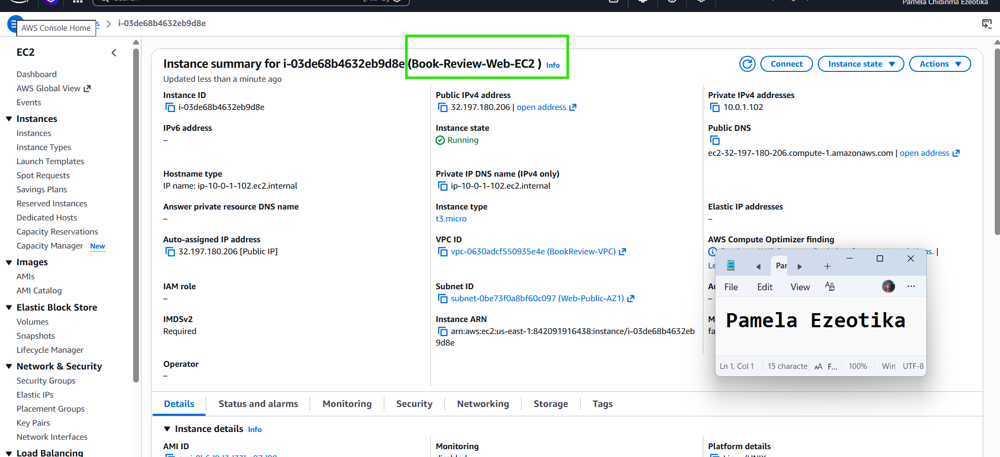
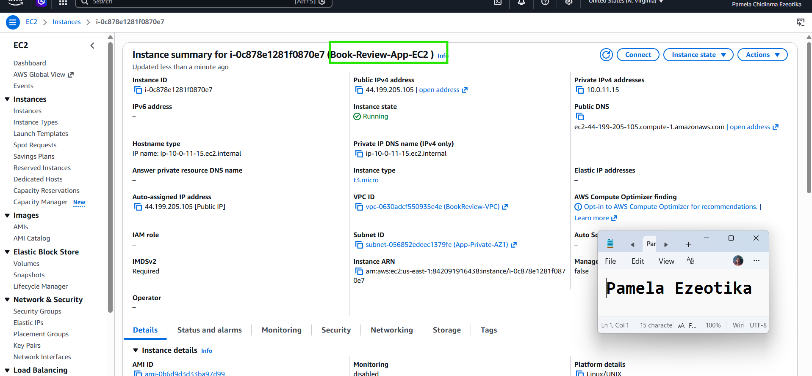
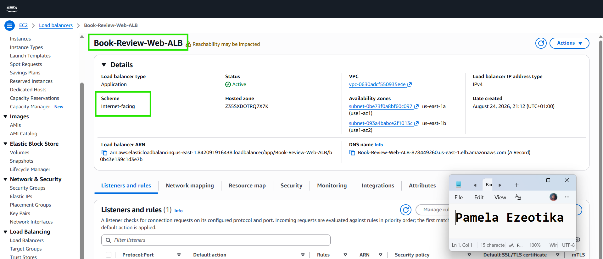
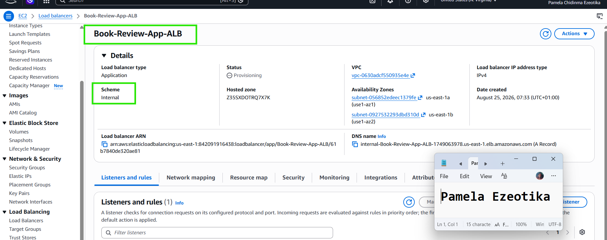
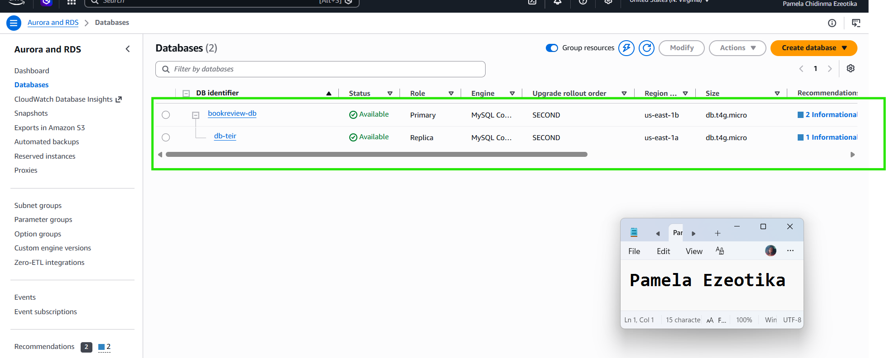
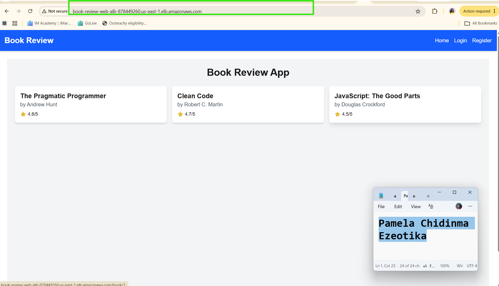
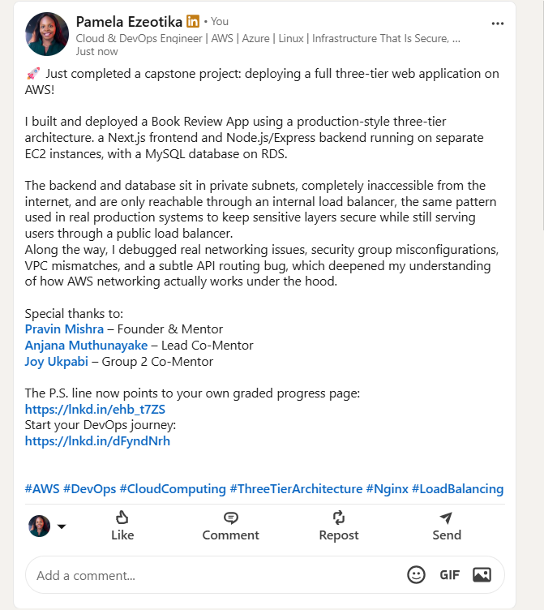

# Assignment 6 — Capstone Assignment — Deploy Book Review App (Three-Tier Architecture) on AWS

Part of the DevOps Micro Internship (DMI) with Agentic AI

---

## Purpose

This is the most important assignment of the course. You will deploy the Book Review App in a fully production-style three-tier architecture on AWS: a Next.js Web Tier behind Nginx and a public ALB, a private Node.js/Express App Tier behind an internal ALB, and a private Multi-AZ MySQL RDS database with a read replica. You are expected to design, deploy, isolate, debug, and document the result independently.

---

# Task 1 — Architecture Diagram

## Goal

Create an architecture diagram showing the custom VPC (10.0.0.0/16), the six subnets across two Availability Zones (two public Web Tier, two private App Tier, two private Database Tier), the public ALB, Web Tier EC2/Nginx, internal ALB, private App Tier EC2, private Multi-AZ RDS with its read replica, and the permitted traffic flow.

### Evidence

#### Diagram image or link

Add your diagram image or link here.

---

# Task 2 — AWS Region & Services Used

## Goal

Record the AWS Region used and list every AWS service used across networking, compute, load balancing, security, and the database.

### Notes

**Region:**

us-east-1 (N. Virginia)

---

**Services:**

VPC (Virtual Private Cloud) Subnets (6 total: 2 public, 4 private) Internet Gateway Route Tables (Public + Private) EC2 Instances (2: Web Tier + App Tier) Application Load Balancer (2: Public + Internal) Security Groups (5: web-alb-sg, web-sg, internal-alb-sg, app-sg, db-sg) RDS MySQL (Single-AZ) NAT Gateway 

---

# Task 3 — Public Entry Point

## Goal

Confirm the Book Review App loads through the public ALB DNS name.

### Evidence

#### Public ALB DNS

Paste your public ALB DNS name here:

`Add your URL here`

---

# Task 4 — Evidence Screenshots

## Goal

Capture visual proof of every tier and load balancer.

### Evidence

#### Web EC2

---

#### App EC2

---

#### Public ALB

---

#### Internal ALB

---

#### RDS + Replica

---

#### App UI proof

---

# Task 5 — Summary

## Goal

Summarize what worked in the final deployment, the issues encountered and how each was fixed, and the tools or sources used to research and debug.

### Notes

**What worked:**

Successfully architected and deployed a highly available, multi-tier AWS infrastructure across multiple Availability Zones (us-east-1a and us-east-1b).

Integrated an Internet-facing Application Load Balancer (book-review-webAlb) routing to Web EC2 instances running Next.js and Nginx.

Configured Nginx as a reverse proxy passing internal API traffic over an Internal ALB (Book-Review-App-ALB) to Express backend instances on Port 3001.

Connected the Express application tier to a Multi-AZ Amazon RDS instance with Read Replica fault tolerance.

Validated end-to-end functionality including homepage book rendering, user registration, authentication, detail page routing, and review submission.

---

**Issues + fixes:**

Path Duplication (404 Not Found on /api/api/books):

Issue: Client-side JavaScript requests duplicated the API path when passing through Nginx.

Fix: Updated Nginx reverse proxy configuration in /etc/nginx/sites-available/book-review under location /api/ by adding a trailing slash to the proxy_pass http:/// directive to automatically strip duplicate prefixes.

Public ALB 503 Service Temporarily Unavailable:

Issue: The Internet-facing ALB had no healthy target instances registered in its Target Group.

Fix: Registered the Web EC2 instance (10.0.1.111) under port 80 within Book-Review-Web-TG, adjusted Security Group rules to allow HTTP port 80 ingress from the public ALB, and verified health check passing on path /.

Inability to access Internal ALB directly from browser:

Issue: Attempting to access internal-Book-Review-App-ALB... directly from a local browser timed out (ERR_CONNECTION_TIMED_OUT).

Fix: Confirmed by design that internal ALBs reside exclusively within private VPC subnets and routed public internet access through the Internet-facing ALB entry point.

---

**Tools/sources used:**

AWS Console (VPC, EC2, RDS, Load Balancers, Security Groups) Claude AI (architecture guidance, debugging, code fixes) Vim (config file editing on EC2) Session Manager (secure terminal access to private instances) Browser DevTools (Network tab for diagnosing API errors) Git (cloning app repository) npm (package management for Node.js/Next.js) pm2 (process management for persistent app running)

---

# LinkedIn Post (Required)

## Goal

Publish a LinkedIn post sharing the capstone deployment, including the public ALB DNS (or a redacted screenshot), three to five lines on what you built and why it is production-style, and one proof screenshot.

## Evidence

#### LinkedIn Post URL

Paste your LinkedIn post URL here:

https://lnkd.in/p/e9SzmqJH

---

#### Screenshot of LinkedIn post

---

# Submission Instructions

- Add all required screenshots and links in your submission
- Do not expose passwords, RDS credentials, connection strings, private keys, or account IDs

---

# Completion Checklist

- [x] Task 1: Architecture diagram completed
- [x] Task 2: AWS Region and services documented
- [x] Task 3: Public ALB DNS confirmed working
- [x] Task 4: All six evidence screenshots captured (Web Tier, App Tier, both ALBs, RDS + replica, app UI)
- [x] Task 5: Deployment summary completed (what worked, issues/fixes, tools/sources)
- [x] LinkedIn post published and URL submitted
- [x] App Tier and Database Tier confirmed not publicly accessible
- [x] No sensitive data exposed

---

## 📌 About DMI & CloudAdvisory

DevOps Micro Internship (DMI) is a project-based DevOps program run by Pravin Mishra (The CloudAdvisory) focused on real-world execution, systems thinking, and career readiness.

It helps learners build strong DevOps foundations with hands-on experience.

---

## 📌 Resources

- 🌐 DMI Official Website: https://dmi.pravinmishra.com?utm_source=github&utm_medium=readme  
- 🎓 University: https://university.pravinmishra.com?utm_source=github&utm_medium=readme  
- 💬 Discord Community: https://discord.pravinmishra.com?utm_source=github&utm_medium=readme  
- 📝 Blog: https://dmi.pravinmishra.com/blog?utm_source=github&utm_medium=readme  
- ▶️ YouTube Playlist: https://www.youtube.com/playlist?list=PLFeSNDtI4Cho  
- 🔗 Pravin Mishra (LinkedIn): https://www.linkedin.com/in/pravin-mishra-aws-trainer/  
- 🏢 CloudAdvisory (LinkedIn): https://www.linkedin.com/company/thecloudadvisory/

---

*This submission is part of DevOps Micro Internship (DMI) — Agentic AI Track.*