# Assignment 7 — AI-Assisted AWS Security and Cost Audit

Part of the DevOps Micro Internship (DMI) with Agentic AI

---

## Purpose

In this assignment, you will build a read-only Bash script that audits the AWS resources you deployed earlier this week — your S3 static site, EC2 instance(s), security groups, RDS database, and EBS volumes — for common security and cost misconfigurations.

You will then connect that script to Claude Code as a reusable `/aws-audit` skill that explains what it found and recommends a fix, without ever making the fix itself.

Finally, you will find a real misconfiguration in your own account, apply the fix yourself, and prove it worked with a second audit run.

---

# Task 1 — Confirm Your AWS Resources and Set Up Your Workspace

## Goal

Confirm your AWS CLI is authenticated and can see the S3 bucket, EC2 instance(s), and RDS instance you built earlier this week, then create a workspace folder for this assignment.

### Evidence

#### Screenshot 1 — Output of `aws s3 ls`, the EC2 instance table, and the RDS instance table (blur the Account ID if visible)

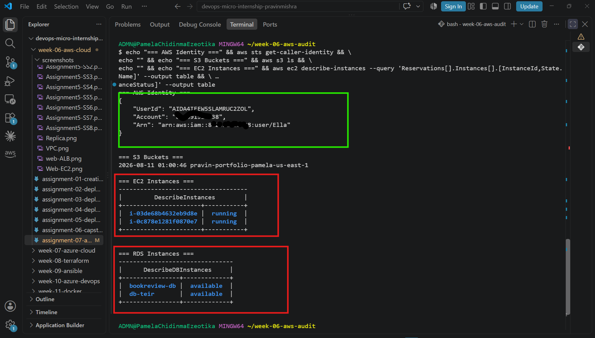

---
Notes You Must Write (Very Important)
1. Which resources from this week's earlier assignments did you see in the listings?

I saw both EC2 instances from the Book Review App capstone (Book-Review-Web-EC2 and Book-Review-App-EC2, both running in us-east-1a), the RDS instance bookreview-db (available), and the S3 bucket pravin-portfolio-pamela-us-east-1

2. Why must you confirm your resources exist before writing an audit script against them?

Validating resource existence ensures AWS CLI queries (describe-, get-, list-*) target active, configured resource identifiers, API schemas, and regions. Running audit queries against nonexistent resources or unauthenticated sessions leads to empty outputs, false positives, or runtime errors.

#### Screenshot 2 — Output of `pwd` and `find . -maxdepth 4 -type d | sort`

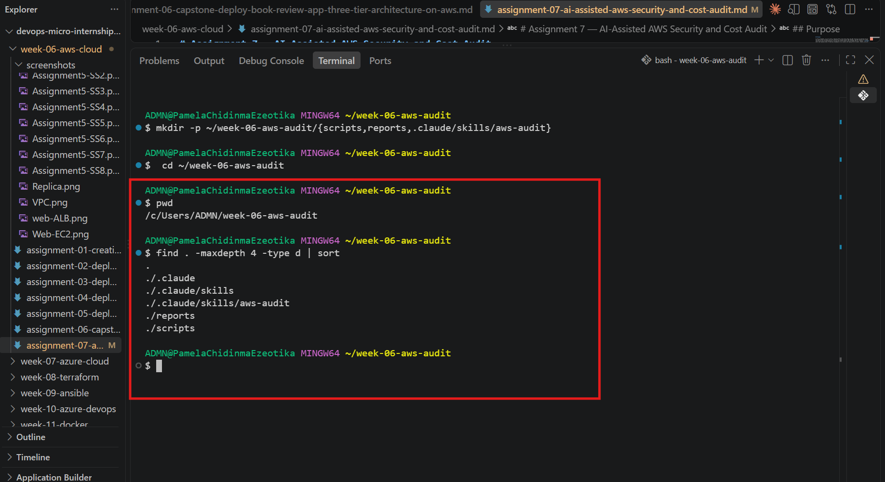

---

### Notes You Must Write (Very Important)

**1. Which resources from this week's earlier assignments did you see in the listings?**

I confirmed that AWS CLI could see resources created during my earlier Week 6 assignments, including my S3 static website bucket, EC2 instances, and Amazon RDS database. For the Book Review capstone, the EC2 resources included instances used for the Web and App tiers, while the RDS listing confirmed the MySQL database used by the application.

**2. Why must you confirm your resources exist before writing an audit script against them?**

I must confirm that the AWS resources exist and that my CLI can access them before writing the audit script because the script depends on querying real resources from my AWS account. This also verifies that my AWS authentication, Region, and permissions are correct. Without this validation, an empty or failed audit could be mistaken for a secure environment when the script may simply be querying the wrong Region, account, or unavailable resources.

---

# Task 2 — Define Safety Rules in CLAUDE.md

## Goal

Create a `CLAUDE.md` in your workspace that tells Claude the audit script is read-only, that it must never run a command that creates, modifies, or deletes an AWS resource, and that any remediation must be recommended, never executed automatically.

### Evidence

#### Screenshot 3 — `CLAUDE.md` open in VS Code showing all four sections

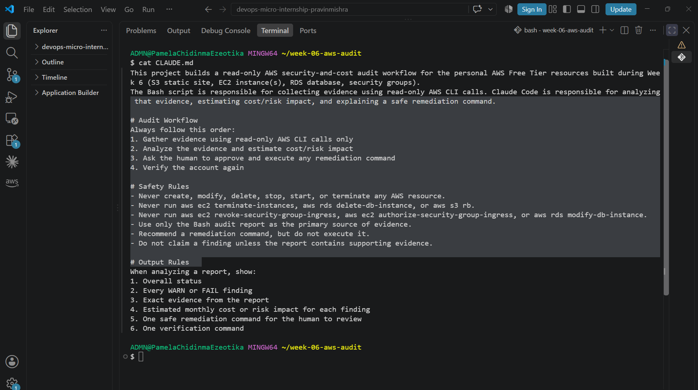

---

### Notes You Must Write (Very Important)

**1. Why should Claude never be given permission to run `revoke-security-group-ingress` itself, even if the fix is obviously correct?**

Claude should never be permitted to run revoke-security-group-ingress automatically because it is a state-changing AWS command. Removing an ingress rule without human review could disrupt legitimate access to a resource or cause an outage. The audit should identify the risk and recommend remediation, while the final decision and execution remain under human control.

**2. Which rule prevents Claude from claiming a finding that the report does not support?**

The Evidence and Reporting Rules prevent Claude from claiming unsupported findings. Claude must only report findings supported by the audit command output. If evidence is unavailable or incomplete, it must report that the check could not be completed rather than assuming the resource is secure or insecure.

---

# Task 3 — Plan the Audit with Claude Code

## Goal

Ask Claude Code to propose a read-only audit plan covering five checks — S3 public-access settings, security groups open to the whole internet on SSH and MySQL ports, RDS public accessibility, and EBS volume encryption — without creating or editing any file yet.

### Evidence

#### Screenshot 4 — Claude Code showing the five-check plan

---

### Notes You Must Write (Very Important)

**1. Which part of this task represents the Gather phase?**

The Gather phase is the collection of AWS resource information using read-only CLI commands. Commands such as list-buckets, get-public-access-block, describe-security-groups, describe-db-instances, and describe-volumes gather the evidence required for the audit without modifying any AWS resources.

**2. Did every proposed command start with `describe-`, `get-`, or `list-`? Why does that matter?**

Yes. The proposed AWS operations used describe-, get-, or list-* actions. This matters because the audit is intended to collect and inspect AWS configuration without changing resource state. Using read-only operations reduces the risk of accidentally modifying, deleting, or disrupting infrastructure during the audit.

---

# Task 4 — Build the AWS Audit Script

## Goal

Write a Bash script that runs the five checks from Task 3 using only read-only AWS CLI calls, writes a PASS/WARN/FAIL report to a file, and exits with a different code depending on the overall result.

Make it executable and confirm it has no syntax errors.

### Evidence

#### Screenshot 5 — Top section of `aws-audit.sh` showing the variables and the checks array

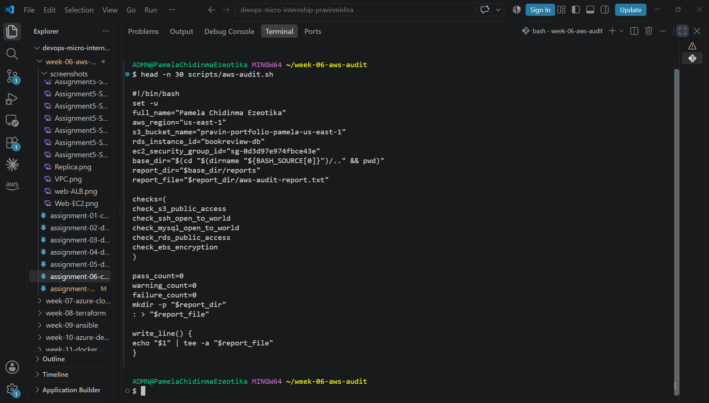

---

#### Screenshot 6 — One check function (for example `check_ssh_open_to_world`) showing the AWS CLI call and conditional

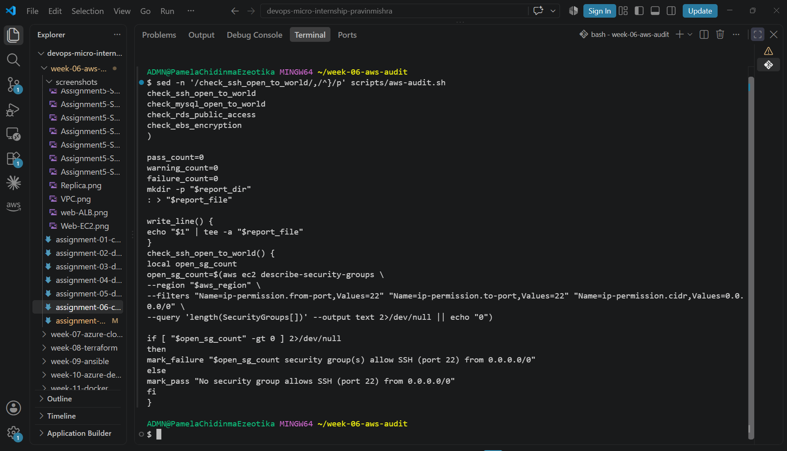

---

#### Screenshot 7 — Output of `bash -n scripts/aws-audit.sh` and `ls -l scripts/aws-audit.sh`

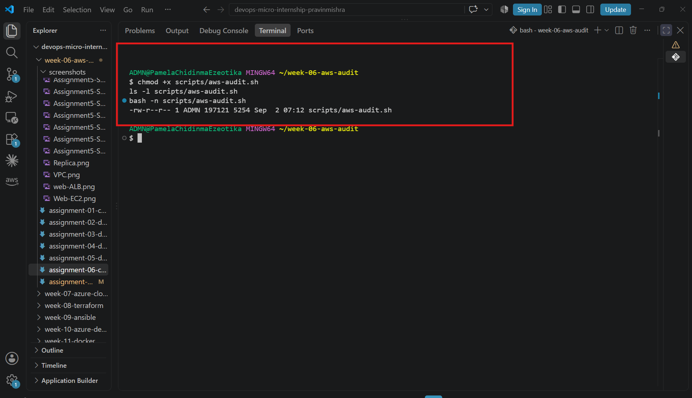

---

### Notes You Must Write (Very Important)

**1. What is stored in the checks array, and how does the loop use it?**

The checks array stores the names of the five Bash functions that perform the AWS audit checks. The for loop iterates through each function name and invokes it, allowing all five audit checks to run in a consistent sequence without repeating the function calls manually.

**2. Why does every AWS CLI call in this script use `--query` and `--output text` instead of parsing raw JSON?**

--query limits the AWS CLI output to only the fields required by each audit check, while --output text converts those values into simple shell-friendly output. This makes the Bash conditionals easier to evaluate and avoids adding a separate JSON parsing dependency such as --jq.

**3. Why does the script use different exit codes for HEALTHY, WARN, and FAIL?**

Different exit codes allow users and automation tools to distinguish the overall audit result without parsing the report text. Exit code 0 represents HEALTHY, 1 represents WARN, and 2 represents FAIL. This makes the script easier to integrate into CI/CD pipelines or other automation while still remaining read-only.

---

# Task 5 — Run the Baseline Audit

## Goal

Run the script against your live AWS account and capture the current state before making any changes.

### Evidence

#### Screenshot 8 — Output of `./scripts/aws-audit.sh` showing your Full Name and all five checks

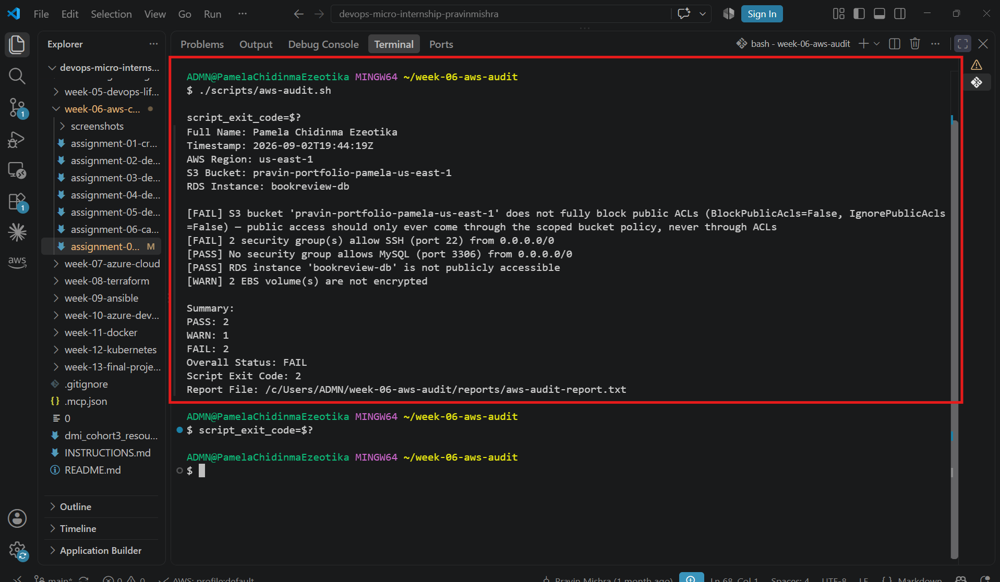

---

#### Screenshot 9 — Output showing the captured exit code and final summary

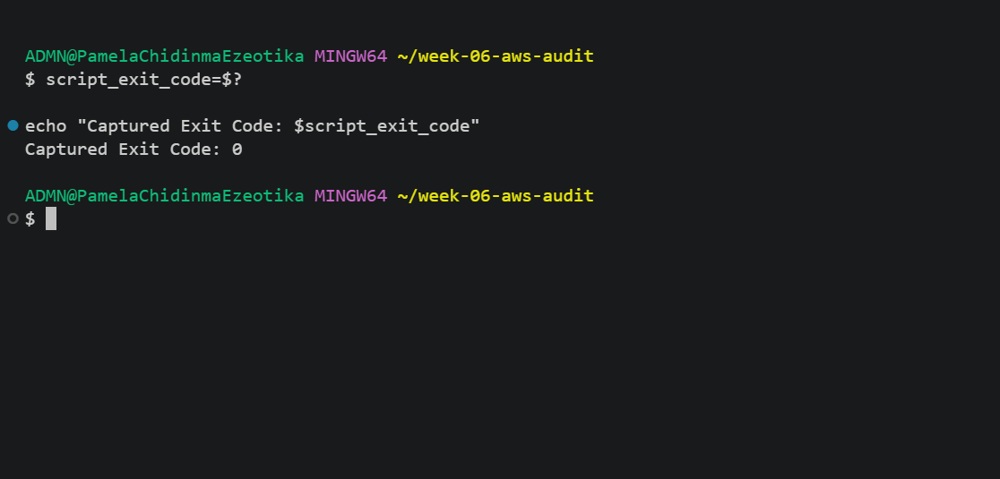

---

### Notes You Must Write (Very Important)

**1. What is the overall status of your baseline audit?**

The overall status of my baseline audit is WARN. The audit identified security and encryption configurations that require review, while other checks passed successfully.

**2. Did any check return FAIL or WARN? If so, which one, and what evidence did it show?**

Yes. The audit returned WARN findings. The S3 public-access check reported that my static website bucket did not have all four bucket-level Public Access Block settings enabled. The SSH check identified a security group allowing port 22 from 0.0.0.0/0, and the EBS encryption check identified unencrypted EBS volumes. The MySQL port 3306 and RDS public-accessibility checks passed.

**3. If every check passed, what does that tell you about the security posture of your account so far?**

If every check passed, it would indicate that the resources tested by the script currently satisfy the defined security controls. However, it would not prove that the entire AWS account is completely secure because the script checks only the specified configurations.

---

# Task 6 — Build and Run the /aws-audit Skill

## Goal

Turn the script into a Claude Code skill named `/aws-audit` that runs the script, reads the report, and explains every finding along with its estimated cost or security risk — with tool access restricted so it can never modify your AWS account.

### Evidence

#### Screenshot 10 — `SKILL.md` showing the frontmatter, tool restrictions, and safety rules

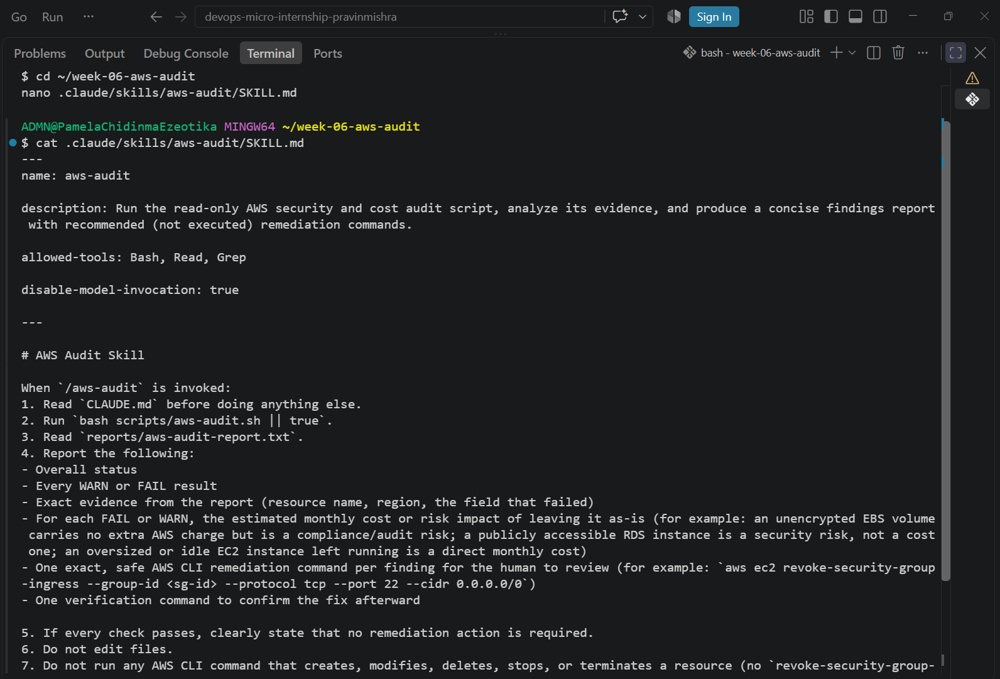

---

#### Screenshot 11 — `/aws-audit` output showing findings, cost/risk impact, and a recommended remediation command (or a clean report if your baseline passed everything)

---

### Notes You Must Write (Very Important)

**1. Why does this skill have Bash, Read, and Grep, but not Write?**

Bash allows the skill to execute the read-only audit script, while Read and Grep allow it to inspect and search the generated report. Write is intentionally excluded so the skill cannot modify the audit files or automatically change configurations as part of remediation.

**2. What part is performed by Bash, and what part is performed by Claude?**

Bash executes the deterministic audit script and collects the AWS configuration evidence. Claude interprets the generated report, explains the PASS/WARN/FAIL findings, assesses their security or cost impact, and recommends remediation without executing it.

**3. Why is estimating cost/risk impact something the AI adds on top of a plain PASS/FAIL script?**

The Bash script identifies whether a resource meets predefined checks, while AI can add context by explaining why a finding matters, its possible security or cost implications, and appropriate remediation. This makes the raw audit results easier to understand and act on.

---

# Task 7 — Fix a Real Finding and Re-Verify

## Goal

Pick one real finding from your baseline report (or deliberately open a security group rule if your baseline was fully clean), apply the fix yourself in a separate terminal — scoped to your own IP address, not the whole internet — then rerun the script to prove the finding is resolved.

### Evidence

#### Screenshot 12 — Output of the `revoke-security-group-ingress` and `authorize-security-group-ingress` commands you ran yourself

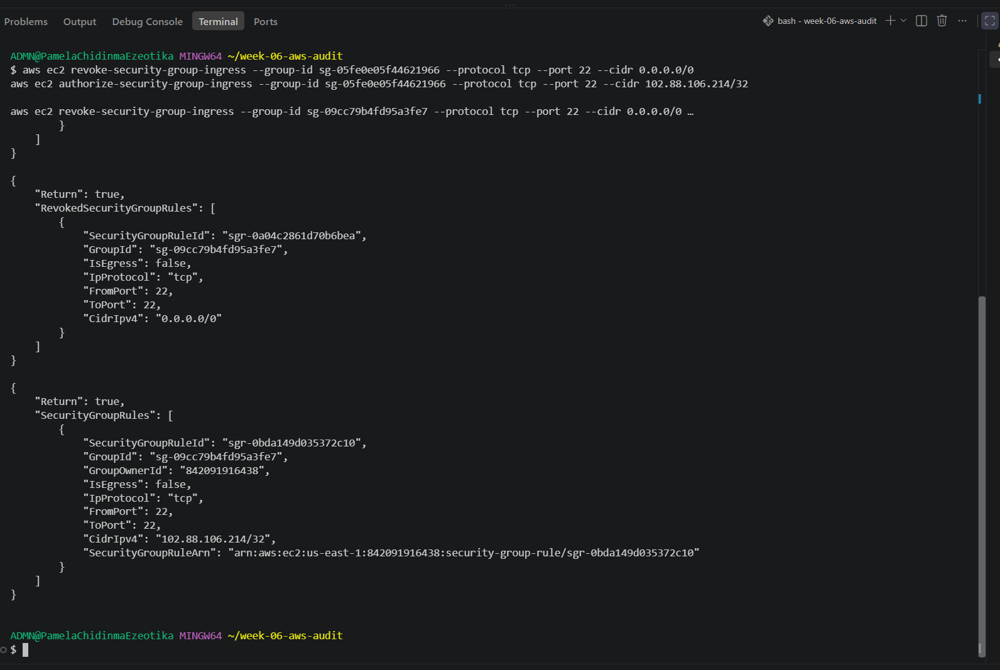

---

#### Screenshot 13 — Rerun of `./scripts/aws-audit.sh` showing the finding is now PASS

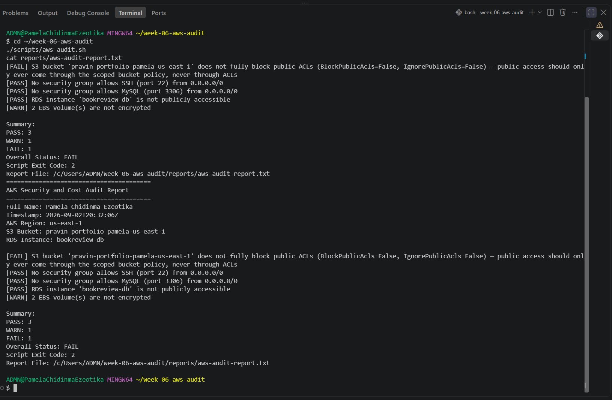

---

### Notes You Must Write (Very Important)

**1. Which exact finding did you fix, and what command did you run?**

I fixed the finding that identified SSH port 22 as being exposed to the whole IPv4 internet through 0.0.0.0/0. I manually revoked the existing ingress rule using aws ec2 revoke-security-group-ingress and then created a replacement SSH rule using aws ec2 authorize-security-group-ingress, restricting access to my current public IP address with a /32 CIDR. 

**2. Why did you scope the new rule to your own IP address instead of leaving it open to `0.0.0.0/0`?**

I restricted SSH access to my own public IP using a /32 CIDR because 0.0.0.0/0 allows connection attempts from anywhere on the IPv4 internet. Restricting the rule follows the principle of least privilege by allowing SSH access only from the specific network location that requires it.

**3. Did Claude execute the remediation command, or did you? Why does that matter?**

I executed the remediation commands manually. Claude only analyzed the audit findings and recommended remediation. This separation matters because the /aws-audit skill is intentionally read-only and must not make changes to AWS resources automatically.

**4. Which phase of the Agentic Loop does the Bash script represent? Which phase does Claude's explanation represent? Which phase is you running the fix?**

The Bash audit script represents the Gather phase because it collects the current AWS configuration and identifies findings. Claude's interpretation represents the Reason phase because it analyzes the evidence, explains the security or cost impact, and recommends remediation. My manual execution of the remediation command represents the Act phase because I reviewed the recommendation and applied the AWS configuration change myself. The second audit run then verifies the result and closes the feedback loop.

---

# LinkedIn Post (Required)

## Goal

Create a LinkedIn post including:

- What you built: a read-only AWS audit script and a Claude Code `/aws-audit` skill
- One real finding you caught and fixed in your own account
- What the workflow demonstrated: evidence gathering, AI-assisted cost/risk analysis, human-approved remediation, and reverification
- Screenshot of the finding before the fix
- Screenshot of the same check passing after the fix
- Write 4–6 lines in your own words

Suggested tags:

`#DMIByPravinMishra #AWS #AgenticAI #ClaudeCode #DevOps`

### Evidence

#### LinkedIn Post URL

Paste your LinkedIn post URL here:

https://lnkd.in/p/eaHwh_gb

---

#### Screenshot of Published LinkedIn Post

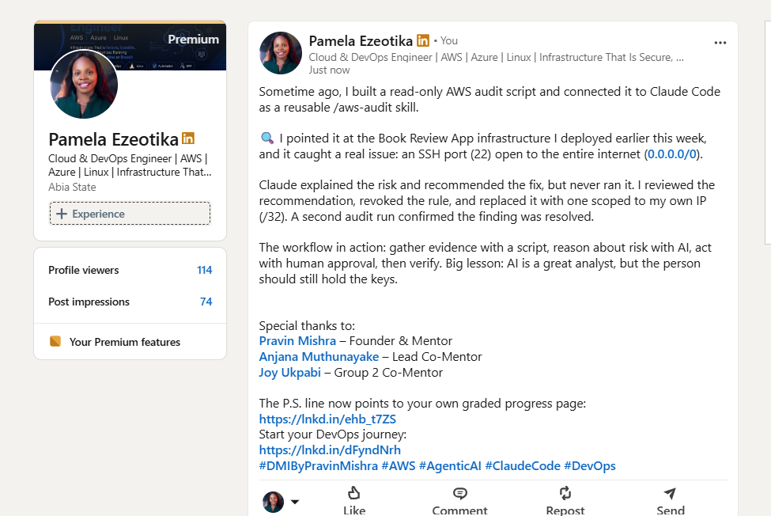

---

# Submission Instructions

Complete all tasks in sequence.

Your submission must include:

- All 13 required task screenshots
- Answers to every **Notes You Must Write** question
- `CLAUDE.md`
- `scripts/aws-audit.sh`
- `.claude/skills/aws-audit/SKILL.md`
- `reports/aws-audit-report.txt` baseline report and the reverified report from Task 7
- GitHub folder or repository URL containing the assignment files
- Your Full Name visible in the required outputs
- LinkedIn post URL
- Screenshot of the published LinkedIn post
- GitHub repository URL (containing all assignment files)

---

# Completion Checklist

- [x] Task 1: AWS resources confirmed and workspace created (Screenshots 1–2)
- [x] Task 2: `CLAUDE.md` created with project context and safety rules (Screenshot 3)
- [x] Task 3: Claude produced a read-only five-check audit plan before any script existed (Screenshot 4)
- [x] Task 4: `aws-audit.sh` built, executable, and passes `bash -n` (Screenshots 5–7)
- [x] Task 5: Baseline audit captured and saved with Full Name visible (Screenshots 8–9)
- [x] Task 6: `/aws-audit` skill loads and runs successfully with no Write permission (Screenshots 10–11)
- [x] Task 7: A real finding was fixed by you and reverified as PASS (Screenshots 12–13)
- [x] Skill never executed a remediation command
- [x] New security group rule is scoped to your own IP, not `0.0.0.0/0`
- [x] All 13 required task screenshots are included
- [x] All "Notes You Must Write" questions are answered in your own words
- [x] No AWS credentials or unblurred account IDs exposed
- [x] LinkedIn post published and URL submitted
- [x] GitHub repository URL included in submission
- [x] All assignment files committed and visible in GitHub repository

---

# Final Submission

Submit your GitHub repository URL containing all assignment files, screenshots, reports, and output.

### GitHub Repository URL

Paste your GitHub repository URL here:

https://github.com/Ella3323/devops-micro-internship-pravinmishra.git

---

## 📌 About DMI & CloudAdvisory

DevOps Micro Internship (DMI) is a project-based DevOps program run by Pravin Mishra (The CloudAdvisory) focused on real-world execution, systems thinking, and career readiness.

It helps learners build strong DevOps foundations with hands-on experience.

---

## 📌 Resources

- 🌐 DMI Official Website: https://dmi.pravinmishra.com?utm_source=github&utm_medium=readme  
- 🎓 University: https://university.pravinmishra.com?utm_source=github&utm_medium=readme  
- 💬 Discord Community: https://discord.pravinmishra.com?utm_source=github&utm_medium=readme  
- 📝 Blog: https://dmi.pravinmishra.com/blog?utm_source=github&utm_medium=readme  
- ▶️ YouTube Playlist: https://www.youtube.com/playlist?list=PLFeSNDtI4Cho  
- 🔗 Pravin Mishra (LinkedIn): https://www.linkedin.com/in/pravin-mishra-aws-trainer/  
- 🏢 CloudAdvisory (LinkedIn): https://www.linkedin.com/company/thecloudadvisory/

---

*This submission is part of DevOps Micro Internship (DMI) — Agentic AI Track.*