# Assignment 04 — Deploy Mini Finance on Azure Using Terraform and Ansible

Part of the DevOps Micro Internship (DMI) with Agentic AI

---

## Purpose

In this assignment, you will provision Azure infrastructure using Terraform and deploy the Mini Finance website using an Ansible multi-play playbook.

Terraform will create the Azure Virtual Machine and networking resources. Ansible will install Nginx, clone the Mini Finance repository, deploy the website, and verify the deployment.

---

# Task 1 — Create the Project Structure

## Goal

Create separate directories and files for the Terraform infrastructure and Ansible configuration.

### Evidence

#### Screenshot 1 — Terminal or VS Code showing the complete `mini-finance` project structure

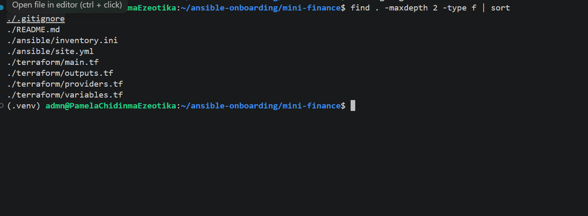

---

### Notes

Add your task notes here.

---

# Task 2 — Create the Azure Infrastructure Using Terraform

## Goal

Use Terraform to provision an Ubuntu Virtual Machine with the required Azure networking and security resources.

### Evidence

#### Screenshot 2 — Terraform code showing the `Allow-SSH` rule for port `22` and the `Allow-HTTP` rule for port `80`

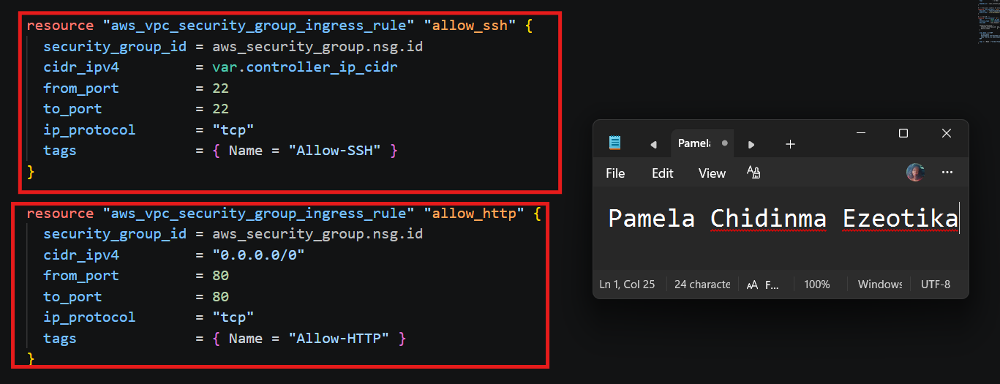

---

#### Screenshot 3 — Terraform code showing the association between `nsg-mini-finance` and `nic-mini-finance`

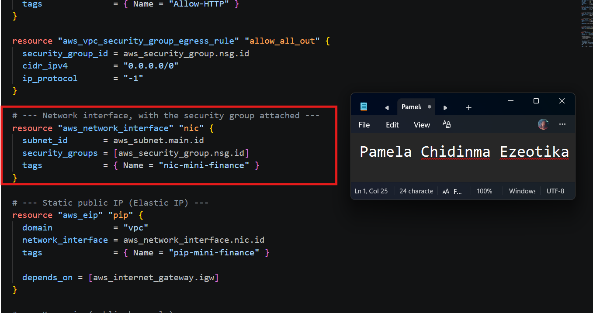

---

### Notes

NSG and NIC Association in Terraform Task Objective: Associate the Network Security Group (nsg-mini-finance) with the Network Interface (nic-mini-finance) using Terraform to enforce security rules at the interface level.

Terraform Resource Implementation:

Terraform resource "aws_network_interface_security_group_association" "nic_nsg_assoc" { network_interface_id = aws_network_interface.nic_mini_finance.id security_group_id = aws_security_group.nsg_mini_finance.id } Key Configuration Details:

Network Interface ID: References the unique identifier of the target NIC resource (aws_network_interface.nic_mini_finance.id).

Security Group ID: References the identifier of the configured security group (aws_security_group.nsg_mini_finance.id).

Outcome: Successfully binds the inbound and outbound firewall rules defined in the security group directly to the VM's network interface.

---

# Task 3 — Initialize and Apply the Terraform Configuration

## Goal

Format and validate the Terraform configuration, review the execution plan, and provision the Azure infrastructure.

### Evidence

#### Screenshot 4 — End of the `terraform apply` output showing `Apply complete!` with no errors

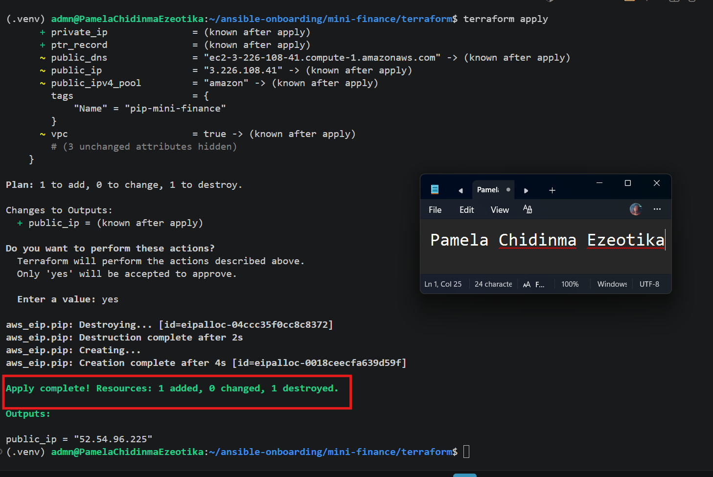

---

#### Screenshot 5 — Output of `terraform output public_ip` showing the VM’s public IP address

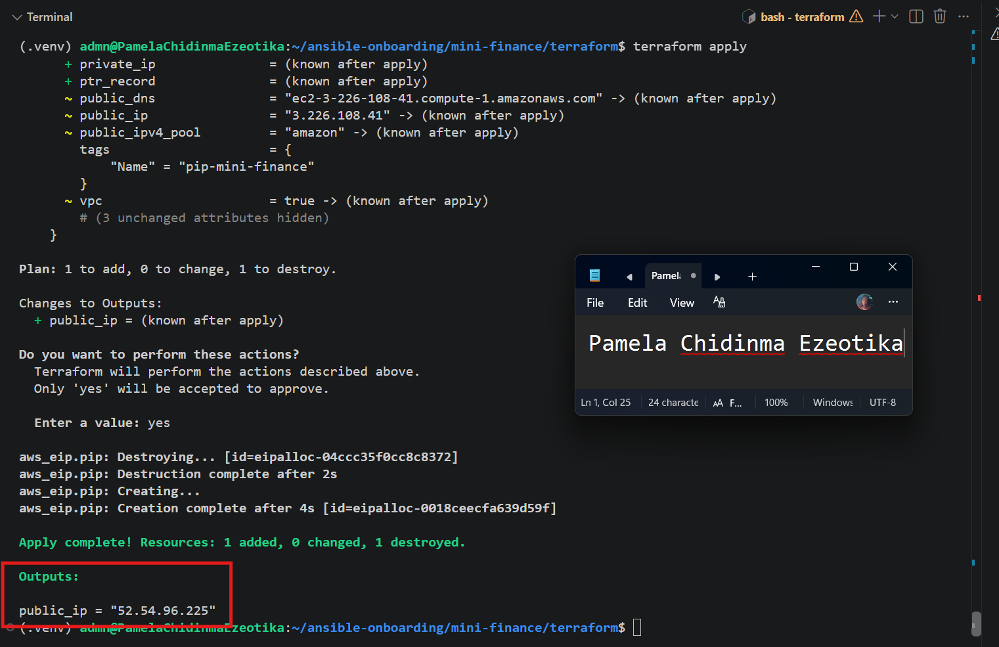

---

### Notes

Challenge: During terraform apply, Terraform created the EC2 instance but failed to attach the Elastic IP to its network interface. AWS returned an IncorrectInstanceState error, because the instance was still in the pending state when Terraform tried to attach the address. The rest of the infrastructure had been created successfully.

Solution: I re-ran terraform apply. Terraform kept everything that already existed and retried only the Elastic IP. By then the instance was running, so the attachment succeeded. To prevent this timing issue, I could also add aws_instance.vm to the Elastic IP’s depends_on, so the address is only attached after the instance exists.

---

# Task 4 — Verify Passwordless SSH Access

## Goal

Confirm that the Ansible controller can connect to the Terraform-provisioned Azure VM using SSH key authentication.

### Evidence

#### Screenshot 6 — Passwordless SSH command and the returned `mini-finance` hostname

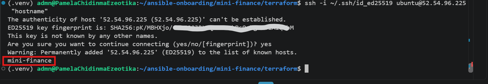

---

### Notes

I tested passwordless SSH connectivity from my Ansible controller to the Azure VM using my existing SSH key. The connection was successful, and the VM returned the hostname mini-finance, confirming that key-based SSH authentication was working correctly.

---

# Task 5 — Create the Ansible Inventory and Verify Connectivity

## Goal

Add the Terraform-provisioned Azure VM to the Ansible inventory and confirm that Ansible can connect to it.

### Evidence

#### Screenshot 7 — Ansible ping output showing `SUCCESS` and `pong` from the Azure VM

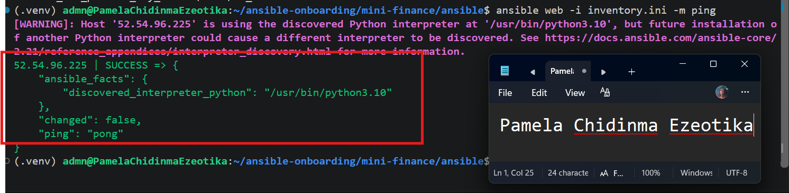

---

### Configuration File

Copy and paste the complete contents of your `ansible/inventory.ini` file below:

[web]
52.54.96.225

[web:vars]
ansible_user=ubuntu
ansible_ssh_private_key_file=~/.ssh/id_ed25519


---

# Task 6 — Create the Multi-Play Ansible Playbook

## Goal

Create one Ansible playbook containing separate plays to install Nginx, deploy the Mini Finance website, and verify the deployment.

### Evidence

#### Screenshot 8 — `site.yml` showing Play 1 and the beginning of Play 2

Screenshot must show:

- Play 1 targeting the `web` group
- Installation of `nginx`, `git`, and `rsync`
- Nginx service configured as started and enabled
- Beginning of Play 2 with the Git repository URL and synchronization task

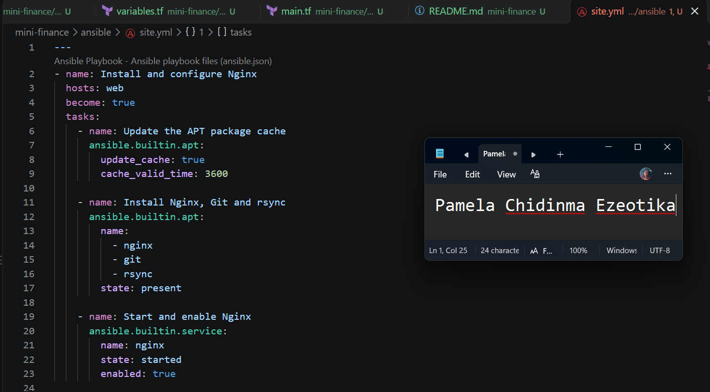

---

#### Screenshot 9 — `site.yml` showing the deployment destination, handler, and Play 3 verification

Screenshot must show:

- Website destination `/var/www/html/`
- Ownership set to `www-data:www-data`
- Nginx reload handler
- Play 3 targeting `localhost`
- The `uri` verification and `assert` condition

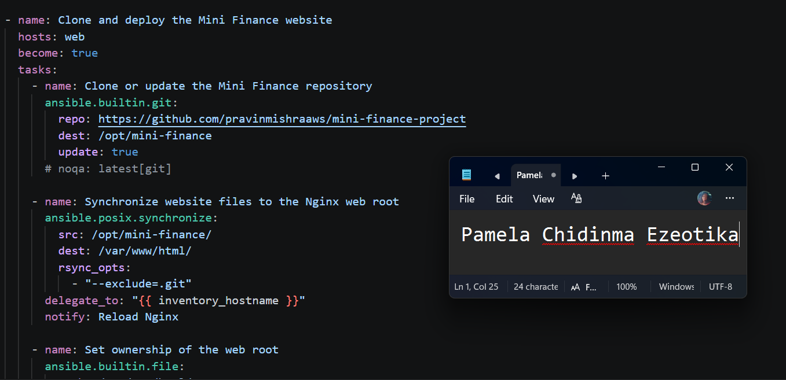

---

### Configuration File

Copy and paste the complete contents of your `ansible/site.yml` file below:

```yaml
---
- name: Install and Start Nginx Web Server
  hosts: web
  become: yes
  tasks:  
    - name: Install Nginx
      apt:
        name: nginx
        state: present
        update_cache: yes
    - name: Start and Enable Nginx
      service:
        name: nginx
        state: started
        enabled: yes

- name: Deploy Mini Finance Website
  hosts: web
  become: yes
  tasks:
    - name: Clone the Mini Finance project from GitHub
      git:
        repo: "https://github.com/pravinmishraaws/mini_finance.git"
        dest: "/tmp/mini_finance"

    - name: Copy website content to web server root
      copy:
        src: "/tmp/mini_finance/"
        dest: "/var/www/html/"
        owner: www-data
        group: www-data
        mode: "0755"
        remote_src: yes

- name: Configure Nginx to Serve the Site
  hosts: web
  become: yes
  tasks:
    - name: Overwrite default Nginx site configuration
      copy:
        dest: /etc/nginx/sites-available/default
        content: |
          server {
            listen 80;
            server_name _;
            root /var/www/html;
            index index.html;
            location / {
              try_files $uri /index.html;
            }
            error_page 404 /index.html;
          }
        owner: root
        group: root
        mode: "0644"

  handlers:
    - name: Reload nginx
      ansible.builtin.service:
        name: nginx
        state: reloaded      

# - name: Restart Nginx After Configuration
#   hosts: web
#   become: yes
#   tasks:
#     - name: Restart Nginx to apply changes
#       service:
#         name: nginx
#         state: restarted

- name: Verify both websites from the controller
  hosts: localhost
  connection: local
  gather_facts: false
  become: false
  tasks:
    - name: Send an HTTP GET request to each web server
      ansible.builtin.uri:
        url: "http://{{ hostvars[item].ansible_host }}"
        status_code: 200
      loop: "{{ groups['web'] }}"
      register: website_checks

    - name: Confirm each server returned HTTP 200
      ansible.builtin.assert:
        that:
          - item.status == 200
        success_msg: "{{ item.item }} returned HTTP {{ item.status }}"
      loop: "{{ website_checks.results }}"


```

---

# Task 7 — Validate and Run the Ansible Playbook

## Goal

Validate the syntax of the multi-play Ansible playbook and run it to install Nginx, deploy the Mini Finance website, and verify the deployment.

### Evidence

#### Screenshot 10 — Successful playbook syntax check showing `playbook: site.yml`

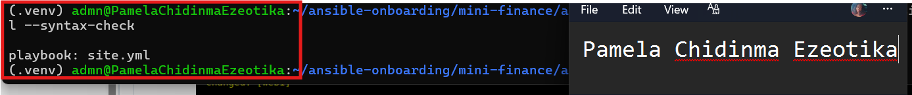

---

#### Screenshot 11 — Play 3 output showing the successful HTTP verification and assertion

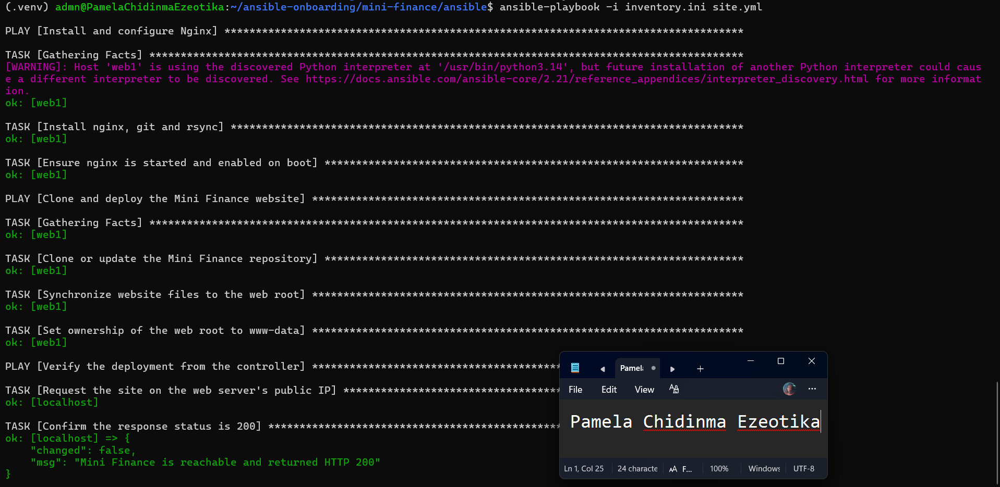

---

#### Screenshot 12 — Final `PLAY RECAP` showing `failed=0` and `unreachable=0`

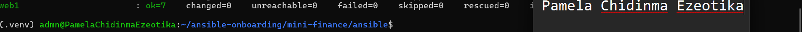

---

### Notes

Run the commands from the ansible directory.

Ensure the Azure VM is running before executing the playbook.

Do not continue if the syntax check reports an error.

If a task fails, read the error message, correct the relevant configuration, and run the playbook again.

---

# Task 8 — Test the Mini Finance Website in a Browser

## Goal

Confirm that the Mini Finance website is publicly accessible through the Azure VM’s public IP address.

### Evidence

#### Screenshot 13 — Mini Finance website successfully loading in the browser, with the Azure VM’s public IP address visible in the address bar

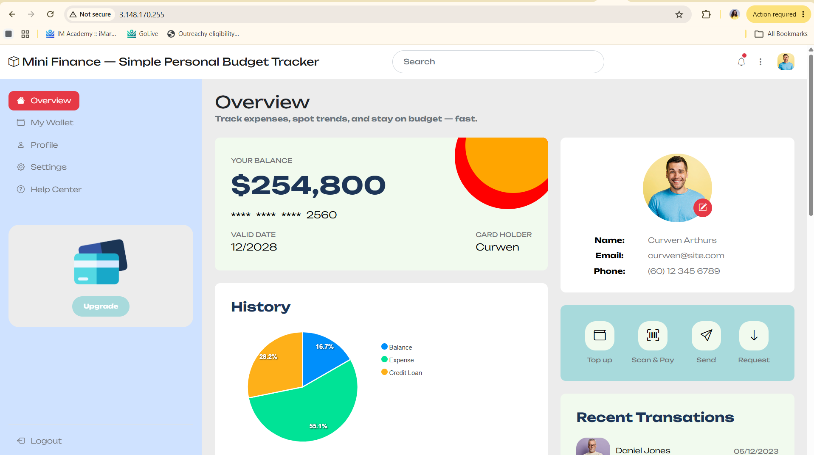

---

### Website URL

Add your deployed website URL below:

```text
http://3.148.170.255
```

---

# Task 9 — Create the Project README

## Goal

Create a `README.md` file to document the Mini Finance infrastructure and deployment project.

### Evidence

#### Screenshot 14 — Completed `README.md` displayed in the VS Code Markdown preview or terminal

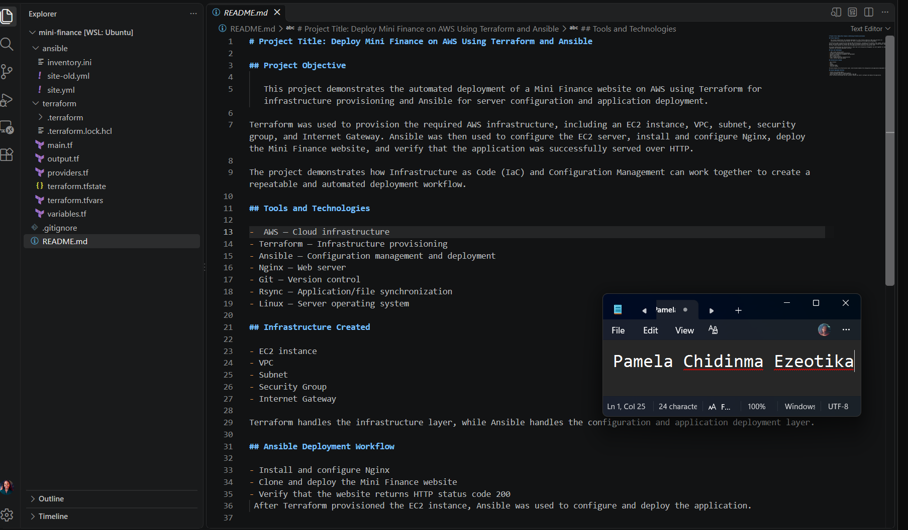

---

### README Content

Copy and paste the complete contents of your `README.md` file below:

```markdown
# Project Title: Deploy Mini Finance on AWS Using Terraform and Ansible

## Project Objective

   This project demonstrates the automated deployment of a Mini Finance website on AWS using Terraform for infrastructure provisioning and Ansible for server configuration and application deployment.

Terraform was used to provision the required AWS infrastructure, including an EC2 instance, VPC, subnet, security group, and Internet Gateway. Ansible was then used to configure the EC2 server, install and configure Nginx, deploy the Mini Finance website, and verify that the application was successfully served over HTTP.

The project demonstrates how Infrastructure as Code (IaC) and Configuration Management can work together to create a repeatable and automated deployment workflow. 

## Tools and Technologies

-  AWS — Cloud infrastructure
- Terraform — Infrastructure provisioning
- Ansible — Configuration management and deployment
- Nginx — Web server
- Git — Version control
- Rsync — Application/file synchronization
- Linux — Server operating system 

## Infrastructure Created

- EC2 instance
- VPC
- Subnet
- Security Group
- Internet Gateway

Terraform handles the infrastructure layer, while Ansible handles the configuration and application deployment layer. 

## Ansible Deployment Workflow

- Install and configure Nginx
- Clone and deploy the Mini Finance website
- Verify that the website returns HTTP status code 200
 After Terraform provisioned the EC2 instance, Ansible was used to configure and deploy the application.


---

# LinkedIn Post Required

## Evidence

#### Screenshot 15 — Published LinkedIn post showing the text and at least one deployment screenshot


---

#### LinkedIn Post URL

Paste your LinkedIn post URL here:

https://lnkd.in/p/eQ7Wb6X7

---

### LinkedIn Submission Notes

**One challenge you faced and how you fixed it:**

None

---

**One real-world example where you can use this learning:**

In an enterprise continuous deployment setup, this pattern allows team members to automatically spin up temporary, isolated staging environments for feature testing. Terraform provisions identical infrastructure on demand, while Ansible configures the web application and verifies health status with an automated HTTP 200 check, eliminating manual setup overhead and reducing configuration drift between testing and production.

---

# Assignment Questions

Answer the following in your own words:

**1. What did you provision using Terraform in this assignment?**

EC2 instance
VPC
Subnet
Security Group
Internet Gateway

---

**2. What did Ansible configure and deploy in this assignment?**

- Install and configure Nginx
- Clone and deploy the Mini Finance website
- Verify that the website returns HTTP status code 200 After Terraform provisioned the EC2 instance, Ansible was used to configure and deploy the application.

---

**3. Why is SSH access on port `22` restricted to your public IP address?**

Restricting SSH access on port 22 to a specific public IP address (/32 CIDR) follows the principle of least privilege. It prevents unauthorized access, limits exposure to internet-wide automated brute-force attacks, and ensures administrative access is only permitted from trusted networks.

---

**4. Why is HTTP port `80` open to the internet?**

HTTP port 80 is open to the internet (0.0.0.0/0) so that public users can access the hosted web application via standard web browsers without administrative restrictions.

---

**5. What is the purpose of the Ansible inventory file?**

The Ansible inventory file acts as a target repository that defines the hostnames, IP addresses, groups, and SSH connection parameters for the managed nodes Ansible will configure and manage.

---

**6. Why does the playbook use separate plays for install, deploy, and verify?**

Separating tasks into distinct plays enforces modularity, logical execution flow, and clear separation of concerns. It allows isolated execution, easier troubleshooting, targeted execution using tags, and ensures health verification runs only after infrastructure configuration is complete

---

**7. Why is `rsync` useful when deploying website files?**

rsync efficiently synchronizes website files by transferring only changed or missing files rather than re-uploading the entire codebase. It preserves file permissions, timestamps, and directory structures, reducing bandwidth usage and deployment time.

---

**8. What does the Ansible `uri` module verify in this assignment?**

The uri module makes an HTTP GET request to the deployed EC2 server's IP address and verifies that the web service returns an expected HTTP 200 OK status code, confirming the website is live and publicly accessible

---

**9. What issue did you face during this assignment, and how did you fix it?**

No issue encountered

---

**10. What did you learn from using Terraform and Ansible together?**

I learned the power of separation of concerns in DevOps: Terraform handles declarative infrastructure provisioning (VPC, Security Groups, EC2), while Ansible manages procedural server configuration (Nginx setup, file deployments, and service health checks). Using both tools together creates a fully automated, repeatable deployment pipeline.

---

# Required Files

Confirm that the following files are included in your assignment folder:

- [x] `.gitignore`
- [x] `README.md`
- [x] `terraform/providers.tf`
- [x] `terraform/main.tf`
- [x] `terraform/variables.tf`
- [x] `terraform/outputs.tf`
- [x] `ansible/inventory.ini`
- [x] `ansible/site.yml`

---

# Submission Instructions

- Add all required screenshots in the correct order.
- Full Name must be visible in required screenshots.
- Add the Azure VM public IP address.
- Add the final Mini Finance website URL.
- Paste `inventory.ini`, `site.yml`, and `README.md` as editable text.
- Answer all assignment questions clearly in your own words.
- Add your LinkedIn post URL.
- Do not expose SSH private keys, passwords, Azure credentials, subscription IDs, Terraform state contents, or other sensitive information.

---

# Completion Checklist

- [ ] Task 1: `mini-finance` project structure created
- [ ] Task 1: `.gitignore` created
- [ ] Task 2: Terraform Azure infrastructure code created
- [ ] Task 2: `Allow-SSH` rule configured for port `22`
- [ ] Task 2: `Allow-HTTP` rule configured for port `80`
- [ ] Task 2: NSG associated with the Network Interface
- [ ] Task 3: `terraform fmt` completed
- [ ] Task 3: `terraform init` completed
- [ ] Task 3: `terraform validate` completed successfully
- [ ] Task 3: `terraform apply` completed successfully
- [ ] Task 3: `terraform output public_ip` displayed the VM public IP
- [ ] Task 4: Passwordless SSH works from the Ansible controller
- [ ] Task 5: `inventory.ini` created
- [ ] Task 5: Ansible ping returns `SUCCESS` and `pong`
- [ ] Task 6: `site.yml` contains three separate plays
- [ ] Task 6: Play 1 installs Nginx, Git, and rsync
- [ ] Task 6: Play 2 clones and deploys the Mini Finance website
- [ ] Task 6: Play 3 verifies HTTP status code `200`
- [ ] Task 7: Playbook syntax check passes
- [ ] Task 7: Ansible playbook completes successfully
- [ ] Task 7: Final recap shows `failed=0` and `unreachable=0`
- [ ] Task 8: Mini Finance website loads in the browser
- [ ] Task 8: Azure VM public IP is visible in the browser screenshot
- [ ] Task 9: `README.md` completed
- [ ] Screenshots 1–15 are included
- [ ] `inventory.ini`, `site.yml`, and `README.md` are pasted as editable text
- [ ] Assignment questions are answered
- [ ] LinkedIn post published with Anyone visibility
- [ ] LinkedIn post URL added
- [ ] No sensitive information is exposed

---

## About DMI & CloudAdvisory

DevOps Micro Internship (DMI) is a project-based DevOps program run by Pravin Mishra and The CloudAdvisory, focused on real-world execution, systems thinking, and career readiness.

It helps learners build strong DevOps foundations with hands-on experience.

---

## Resources

- DMI Official Website: [https://dmi.pravinmishra.com?utm_source=github&utm_medium=readme](https://dmi.pravinmishra.com?utm_source=github&utm_medium=readme)
- University: [https://university.pravinmishra.com?utm_source=github&utm_medium=readme](https://university.pravinmishra.com?utm_source=github&utm_medium=readme)
- Discord Community: [https://discord.pravinmishra.com?utm_source=github&utm_medium=readme](https://discord.pravinmishra.com?utm_source=github&utm_medium=readme)
- Blog: [https://dmi.pravinmishra.com/blog?utm_source=github&utm_medium=readme](https://dmi.pravinmishra.com/blog?utm_source=github&utm_medium=readme)
- YouTube Playlist: [https://www.youtube.com/playlist?list=PLFeSNDtI4Cho](https://www.youtube.com/playlist?list=PLFeSNDtI4Cho)
- Pravin Mishra LinkedIn: [https://www.linkedin.com/in/pravin-mishra-aws-trainer/](https://www.linkedin.com/in/pravin-mishra-aws-trainer/)
- CloudAdvisory LinkedIn: [https://www.linkedin.com/company/thecloudadvisory/](https://www.linkedin.com/company/thecloudadvisory/)

---

*This submission is part of DevOps Micro Internship (DMI) — Agentic AI Track.*