# Assignment — Deploy EpicBook with Terraform and Ansible Roles

Part of the DevOps Micro Internship (DMI) with Agentic AI

---

## Purpose

In this assignment, you will deploy the EpicBook web application using Terraform and Ansible roles.

Terraform provisions the cloud infrastructure, including one Ubuntu VM and one managed MySQL database. Ansible roles configure the VM, install required software, deploy the EpicBook application, configure Nginx, connect the app to the managed MySQL database, and verify the deployment.

---

# Task 1 — Set Up the Project Folder Layout

## Goal

Create the project folder structure for Terraform and Ansible roles.

Terraform will be used to provision the cloud infrastructure. Ansible roles will be used to configure the VM and deploy the EpicBook application.

### Evidence

#### Screenshot 1 — Terminal showing the completed `epicbook-prod` project structure

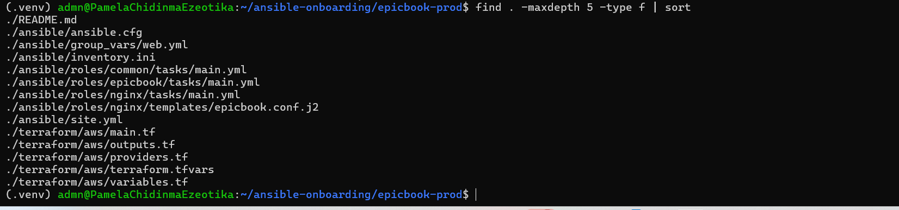

---

### Notes

Answer the following in your own words:

**1. Which cloud provider did you choose for this assignment?**

AWS Cloud Provider

---

**2. Why is it useful to keep Terraform files and Ansible files in separate folders?**

Keeping Terraform and Ansible files in separate folders keeps the project organized and easier to manage. Terraform is used to create infrastructure, while Ansible is used to configure servers. It also makes troubleshooting easier because each tool has a clear responsibility. This separation helps teams maintain and automate infrastructure more efficiently.

---

**3. What is the purpose of the `roles` directory in Ansible?**

The roles directory in Ansible is used to organize reusable automation tasks. Each role can manage a specific function, such as installing Nginx or configuring a database. It keeps playbooks clean, modular, and easier to maintain.

---

# Task 2 — Provision the Infrastructure with Terraform

## Goal

Run Terraform to provision the cloud infrastructure for the EpicBook deployment.

Terraform will create the VM, managed MySQL database, networking, security rules, and required outputs.

### Evidence

#### Screenshot 2 — `terraform apply` completed successfully

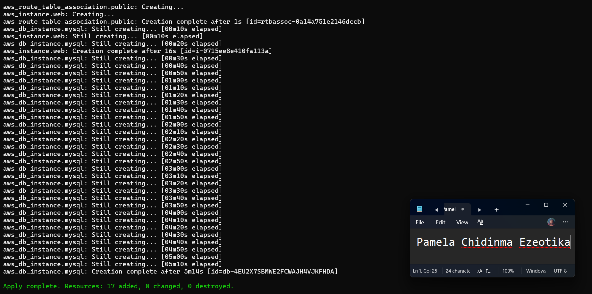

---

#### Screenshot 3 — Output of `terraform output`

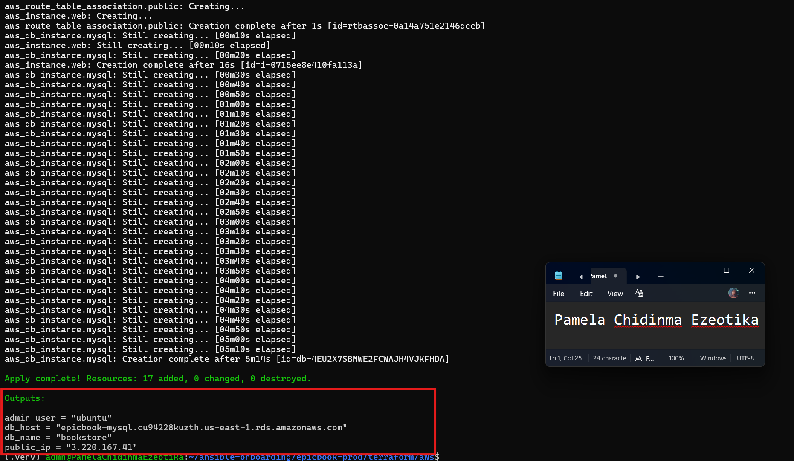

---

#### Screenshot 4 — Azure Portal or AWS Console showing the VM running

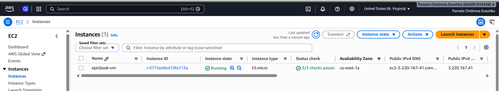

---

#### Screenshot 5 — Azure Portal or AWS Console showing the managed MySQL database created

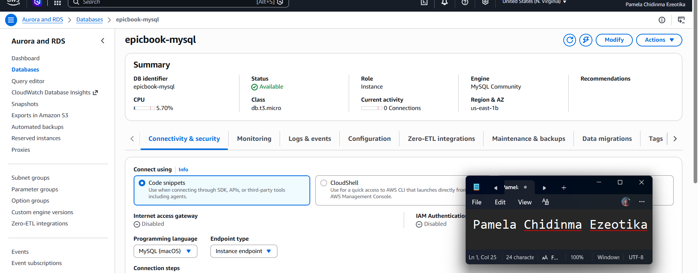

---

### Notes

Answer the following in your own words:

**1. What resources did Terraform create for this assignment?**

1. VPC
2. SUBNET
3. INTERNET GATEWAY
4. RDS DATABSE
5. EC2 INSTANCE
6. SECURITY GROUP
7. ROUTE TABLE
8. KEY PAIR
9. DATABSE SUBNET GROUP

---

**2. Why should you review `terraform plan` before running `terraform apply`?**

terraform plan shows what changes Terraform will make before applying them. Reviewing it helps you catch unexpected resource creation, modification, or deletion. This reduces the risk of accidental infrastructure changes or downtime.

---

**3. Why should database passwords not be shown in Terraform output?**

Database passwords should not appear in Terraform output because they are sensitive credentials. Exposing them can allow unauthorized users to access the database. Keeping them hidden helps protect security and confidential information.

---

# Task 3 — Verify SSH Key-Based Access

## Goal

Verify that the cloud VM can be accessed from the Ansible controller using SSH key-based authentication.

### Evidence

#### Screenshot 6 — Successful SSH hostname check from the Ansible controller

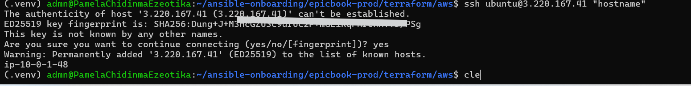

---

### Notes

Answer the following in your own words:

**1. What command did you use to verify SSH access?**

ssh ubuntu@3.220.167.41 "hostname"

---

**2. What proves that SSH key-based access worked successfully?**

The command returned the VM's hostname (ip-10-0-1-48) and I was never asked
for a password. The only prompt was the one-time host fingerprint confirmation,
which I accepted. This means the VM accepted my private key
(~/.ssh/id_ed25519) against the public key Terraform uploaded when it created
the VM.

---

**3. What would you check if SSH returned `Permission denied (publickey)`?**

I would check these in order:
1. The username matches the VM image (ubuntu for Ubuntu).
2. The private key on my controller matches the public key Terraform uploaded
   to the VM.
3. SSH is actually offering that key: test with ssh -i ~/.ssh/id_ed25519 ...
   and, if that works, load it into the agent with ssh-add.
4. The private key file has safe permissions (chmod 600).
5. I am connecting to the right public IP, and the security group still allows
   port 22 from my current public IP.

---

# Task 4 — Create the Ansible Inventory and Configuration

## Goal

Create the Ansible inventory file and local Ansible configuration for the EpicBook VM.

The inventory tells Ansible which VM to manage and which SSH user to use.

### Evidence

#### Screenshot 7 — `inventory.ini` showing the VM under the `web` group

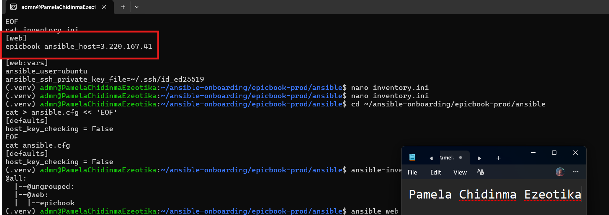

---

#### Screenshot 8 — Output of `ansible-inventory -i inventory.ini --graph`

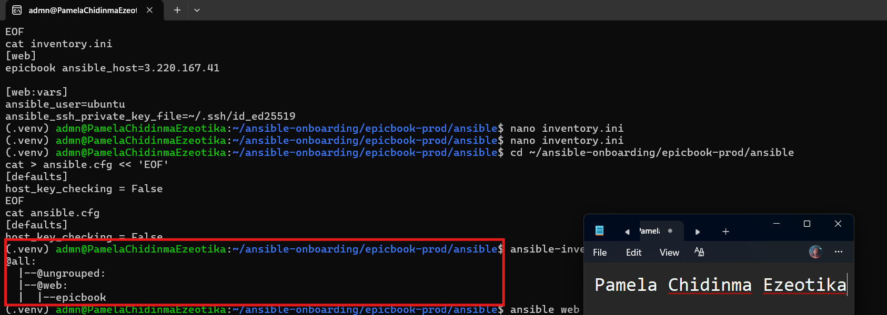

---

#### Screenshot 9 — Output of `ansible web -i inventory.ini -m ping`

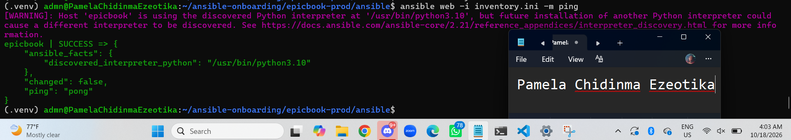

---

### Notes

Answer the following in your own words:

**1. What is the purpose of `inventory.ini`?**

inventory.ini tells Ansible which servers to manage. It contains the servers’ IP addresses, hostnames, and connection details. It allows Ansible to know where to run playbooks and tasks.

---

**2. What does `ansible_host` store?**

ansible_host stores the IP address or hostname of the target server. It tells Ansible where to connect using SSH.

---

**3. What does `ansible_ssh_private_key_file` tell Ansible?**

ansible_ssh_private_key_file tells Ansible which private SSH key to use when connecting to a server. It allows Ansible to authenticate securely using key-based SSH access.

---

**4. Why is `host_key_checking = False` used only for this temporary lab?**

host_key_checking = False skips SSH host-key verification, making a temporary lab easier to set up. It is not recommended for production because it can weaken SSH security and allow connections to an untrusted host.

---

# Task 5 — Create the Main Ansible Playbook

## Goal

Create the main Ansible playbook that runs the required roles in the correct order.

The `site.yml` file will call the `common`, `nginx`, and `epicbook` roles.

### Evidence

#### Screenshot 10 — `site.yml` showing the roles in the correct order

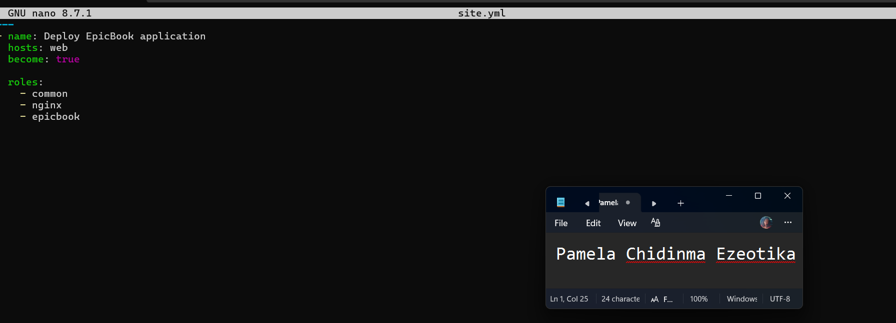

---

#### Screenshot 11 — Output of `ansible-playbook -i inventory.ini site.yml --syntax-check`

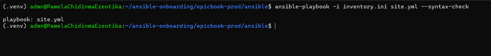

---

### Notes

Answer the following in your own words:

**1. What is the purpose of `site.yml`?**

site.yml is the main Ansible playbook that defines what tasks should be run on the servers. It can call different roles to configure and manage the infrastructure.

---

**2. Why should the roles run in the order `common`, `nginx`, and `epicbook`?**

The roles should run in that order because each step depends on the previous one. common sets up basic requirements, nginx installs/configures the web server, and epicbook deploys the application. This ensures the server is properly prepared before the application is deployed.

---

**3. What does `become: true` allow Ansible to do?**

become: true allows Ansible to run tasks with elevated privileges, usually as the root user. It is commonly needed for tasks like installing packages or modifying system files.

---

# Task 6 — Create the `common` Role

## Goal

Create the `common` role to prepare the Ubuntu VM with the basic packages required for the EpicBook deployment.

This role handles the common server setup before Nginx and the application are configured.

### Evidence

#### Screenshot 12 — `roles/common/tasks/main.yml` showing the common setup tasks

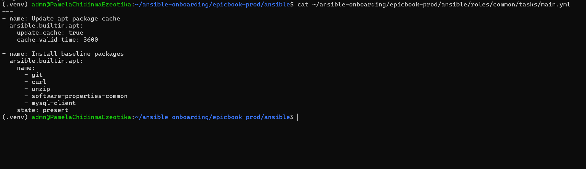

---

### Notes

Answer the following in your own words:

**1. What is the responsibility of the `common` role?**

The common role handles basic server setup and common requirements. It may install essential packages, create users, and configure basic system settings. This prepares the server for the other roles.

---

**2. Why should Nginx installation not be placed inside the `common` role?**

Nginx should not be in common because it is a specific web-server service, not a basic server requirement. Keeping it separate makes roles modular, reusable, and easier to maintain.

---

**3. Why is `mysql-client` useful in this deployment?**

mysql-client allows the application server to connect to and interact with a MySQL database. It provides tools needed to run queries and test database connectivity.

---

# Task 7 — Create the `nginx` Role

## Goal

Create the `nginx` role to install Nginx and configure it as a reverse proxy for the EpicBook application.

Nginx will receive browser traffic on port `80` and forward it to the EpicBook Node.js application running on the VM.

### Evidence

#### Screenshot 13 — `roles/nginx/tasks/main.yml` showing Nginx installation and site configuration tasks

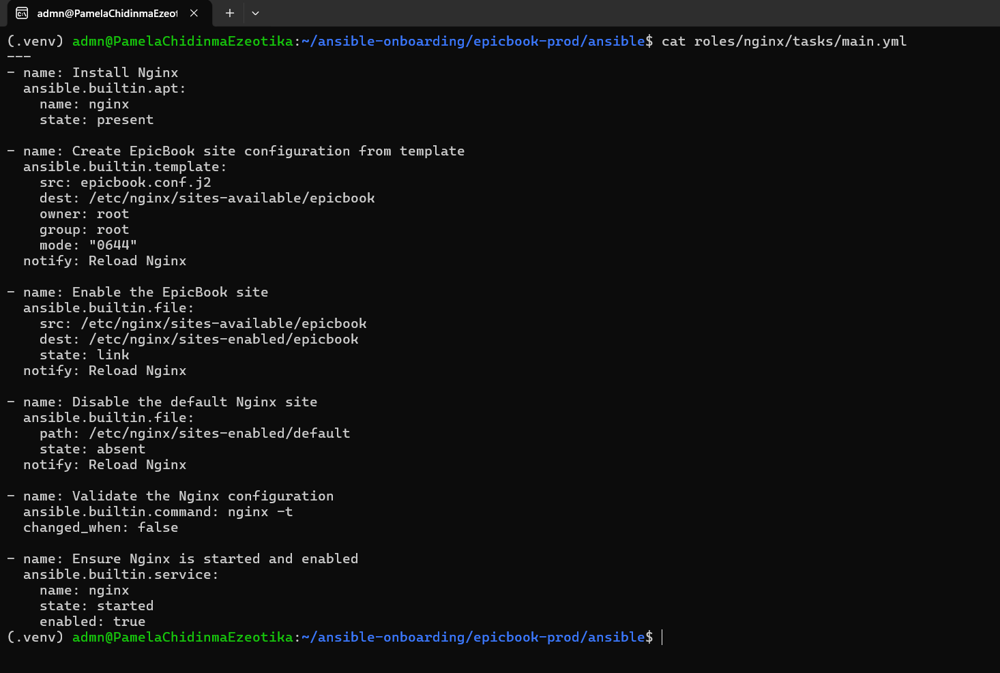

---

#### Screenshot 14 — `roles/nginx/templates/epicbook.conf.j2` showing the reverse proxy configuration

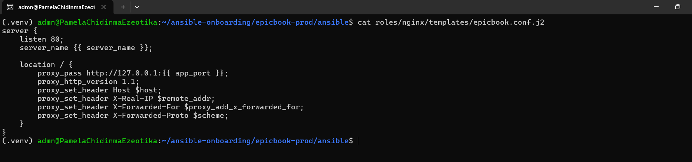

---

### Notes

Answer the following in your own words:

**1. What is the responsibility of the `nginx` role?**

To install the Nginx web server, deploy custom virtual host configuration templates, and ensure the service is enabled and running.

---

**2. Why is Nginx configured as a reverse proxy in this deployment?**

To securely receive client HTTP traffic on port 80 and forward requests safely to the backend Node.js application running internally on port 8080.

---

**3. Why should the application port come from `group_vars/web.yml` instead of being hard-coded?**

It centralizes configuration parameters, making it easier to change application ports across templates and tasks without modifying role logic.

---

# Task 8 — Create the `epicbook` Role

## Goal

Create the `epicbook` role to deploy the EpicBook application, connect it to the managed MySQL database, and run the application on port `8080` using PM2.

### Evidence

#### Screenshot 15 — `roles/epicbook/tasks/main.yml` showing application deployment tasks

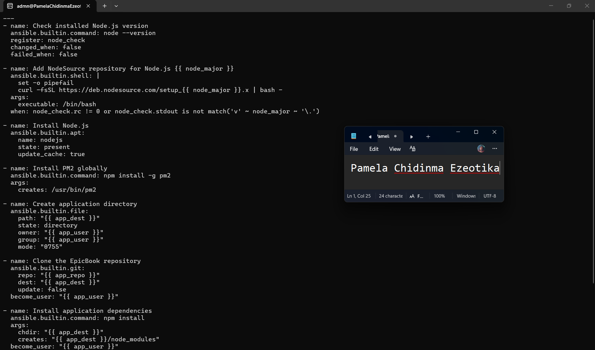

---

#### Screenshot 16 — Task or file showing how the database connection is configured, with secrets hidden

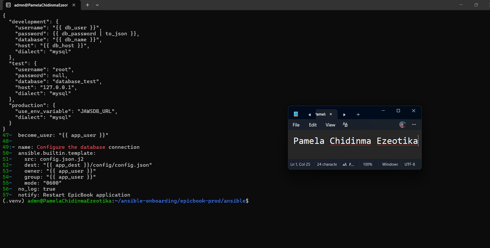

---

#### Screenshot 17 — Task or output showing the EpicBook application managed by PM2

---

### Notes

Answer the following in your own words:

**1. What is the responsibility of the `epicbook` role?**

To clone or copy the application code, install Node.js dependencies, configure database environment variables, and manage the process using PM2.

---

**2. Why is PM2 used for the EpicBook Node.js application?**

It functions as a production process manager that restarts the application automatically on crashes, handles background execution, and maintains system logs

---

**3. Why should database passwords not be hard-coded in public files?**

Hard-coding plaintext credentials in shared or public repositories risks unauthorized database access and data compromise.

---

**4. What does it mean for the application to run on port `8080` while Nginx listens on port `80`?**

Clients connect to Nginx publicly on standard HTTP port 80, while Nginx internally proxies traffic to the Node.js application listening locally on port 8080.

---

# Task 9 — Create Group Variables

## Goal

Create reusable variables for the EpicBook deployment.

The `group_vars/web.yml` file stores values that can be reused across the Ansible roles.

### Evidence

#### Screenshot 18 — `group_vars/web.yml` showing the application, PM2, and database variables, with passwords hidden or masked

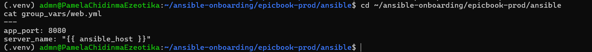

---

### Notes

Answer the following in your own words:

**1. What is the purpose of `group_vars/web.yml`?**

To store global variables, application settings, and database connection parameters mapped specifically to the web inventory group

---

**2. Which values did you store in `group_vars/web.yml`?**

Application port, node environment settings, database host endpoint, database username, database name, and database password secrets

---

**3. How did you handle the database password securely?**

By isolating variables within restricted group variable files and planning for encryption or secure environment variable injection.

---

# Task 10 — Run the Ansible Playbook

## Goal

Run the Ansible playbook to configure the VM and deploy the EpicBook application.

The playbook should run the roles in this order:

1. `common`
2. `nginx`
3. `epicbook`

### Evidence

#### Screenshot 19 — Ansible playbook output showing the roles running

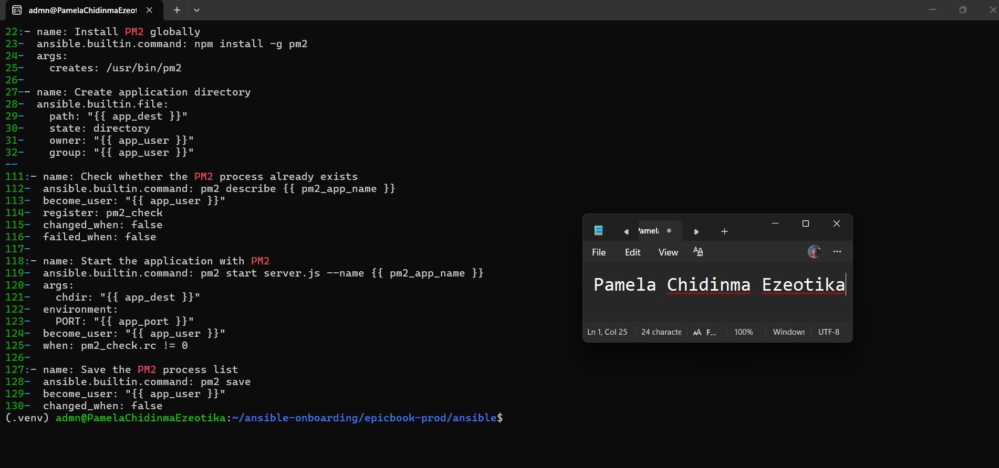

---

#### Screenshot 20 — Final Ansible recap showing `failed=0`

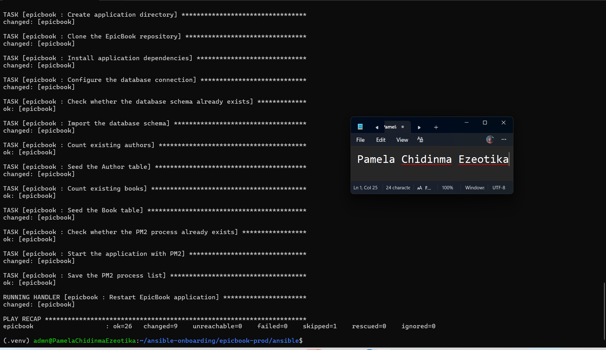

---

#### Screenshot 21 — Output of `ansible web -i inventory.ini -m command -a "systemctl is-active nginx" --become`

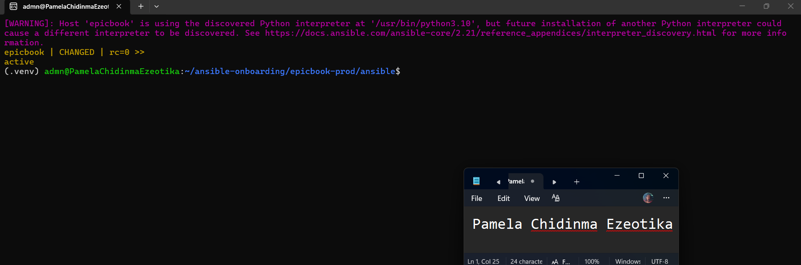

---

#### Screenshot 22 — Output of `ansible web -i inventory.ini -m command -a "pm2 status"`

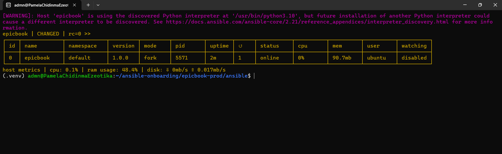

---

#### Screenshot 23 — Output of `ansible web -i inventory.ini -m command -a "curl -I http://localhost:8080"`

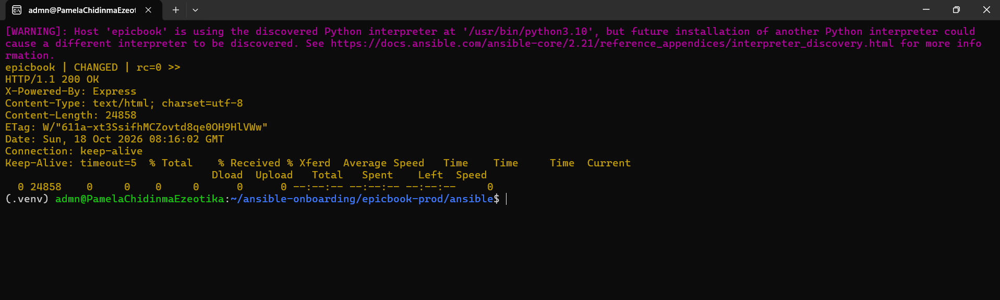

---

### Notes

Answer the following in your own words:

**1. What command did you run to execute the Ansible playbook?**

ansible-playbook -i inventory.ini site.yml

---

**2. How do you know all roles completed successfully?**

The final execution summary output reported zero failed tasks across all applied roles.

---

**3. What proves that Nginx is active?**

The systemctl is-active nginx command returned an active status.

---

**4. What proves that PM2 is managing the EpicBook application?**

The pm2 status command showed the epicbook process running with an online status

---

**5. What proves that the EpicBook application responds on port `8080`?**

Running curl -I http://localhost:8080 returned a valid HTTP response from the application server.

---

# Task 11 — Verify the EpicBook Deployment

## Goal

Verify that the EpicBook application is running, accessible in the browser, and connected to the managed MySQL database.

### Evidence

#### Screenshot 24 — Output of `curl -I http://<public_ip>`

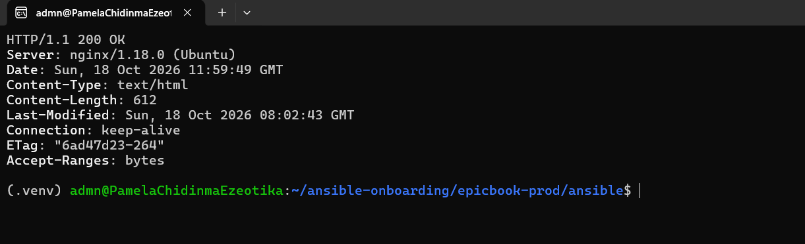

---

#### Screenshot 25 — Output of the cart API test command

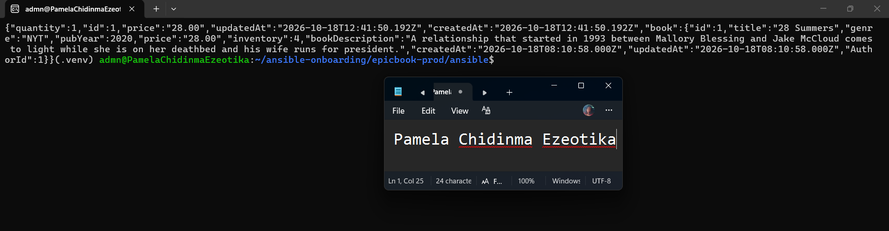

---

#### Screenshot 26 — Output of the `/cart` HTTP status check

---

#### Screenshot 27 — Browser showing the EpicBook application loaded from `http://<public_ip>`

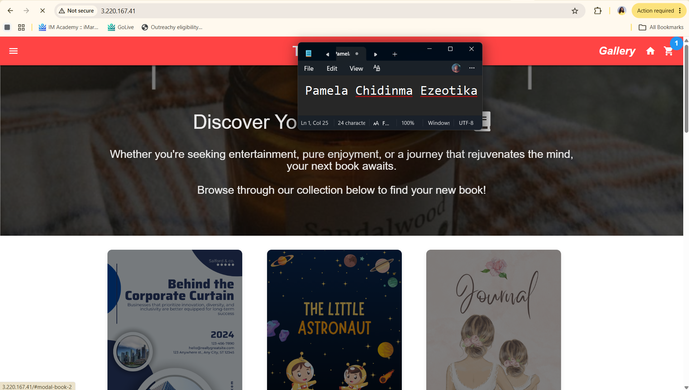

---

### Notes

Answer the following in your own words:

**1. What HTTP response did you receive from the public application URL?**

An HTTP/1.1 200 OK response.

---

**2. What did the cart API test prove?**

It proved that backend route handlers and API endpoints were fully operational.

---

**3. What did the `/cart` status check return?**

An HTTP 200 OK status code.

---

**4. What issue did you face during verification, and how did you fix it?**

PM2 initially started the application without loading database environment variables, causing Sequelize to crash with a connection refused error on port 3306. This was fixed by creating a PM2 ecosystem configuration file (ecosystem.config.js) to explicitly inject the correct Azure MySQL credentials and port settings.

---

# LinkedIn Post Required

## Evidence

#### LinkedIn Post URL

Paste your LinkedIn post URL here:

`Add your URL here`

---

#### Screenshot — Published LinkedIn post

Add your screenshot here.

---

# Assignment Questions

Answer the following in your own words:

**1. Why is Terraform used for infrastructure provisioning?**

It provides declarative Infrastructure as Code to deploy cloud resources consistently and repeatably.

---

**2. Why are Ansible roles useful for production-style deployments?**

They establish an organized directory structure that cleanly modularizes tasks, templates, and handlers for scalability

---

**3. What is the purpose of `group_vars/web.yml`?**

To centralize host-group specific configuration variables and maintain separation from playbook logic.

---

**4. Why should database passwords not be committed to GitHub?**

To prevent sensitive security credentials from being exposed publicly in version history

---

**5. What is the purpose of Nginx in this deployment?**

To act as a reverse proxy handling client web traffic on port 80 and forwarding requests to the application.

---

**6. Why should the managed MySQL database not be publicly accessible?**

To protect backend data storage from unauthorized external exposure and network attacks.

---

**7. Why is PM2 used for the EpicBook Node.js application?**

To guarantee application uptime, handle process restarts automatically, and manage background logging.

---

**8. What does idempotency mean in Ansible?**

The ability to run playbooks multiple times safely so that changes are applied only when differences exist.

---

**9. What issue did you face during the deployment, and how did you fix it?**

Environment variables weren't picked up automatically by PM2 during startup, which was resolved by implementing an explicit ecosystem configuration file (ecosystem.config.js).

---

**10. What security improvement would you make before using this setup in production?**

I would integrate Ansible Vault for credential encryption, configure HTTPS using SSL/TLS certificates, and strictly restrict cloud firewall security rules.

---

# Required Files

Confirm that the following files are included in your GitHub repository or assignment folder:

- [x] `README.md`
- [x] Terraform files under either `terraform/azure/` or `terraform/aws/`
- [x] `ansible/ansible.cfg`
- [x] `ansible/inventory.ini`
- [x] `ansible/site.yml`
- [x] `ansible/group_vars/web.yml`
- [x] `ansible/roles/common/tasks/main.yml`
- [x] `ansible/roles/nginx/tasks/main.yml`
- [x] `ansible/roles/nginx/templates/epicbook.conf.j2`
- [x] `ansible/roles/epicbook/tasks/main.yml`

---

# Submission Instructions

- Add all required screenshots in your submission.
- Full Name must be visible in required screenshots.
- Mention the cloud provider used: Azure or AWS.
- Add the VM public IP address.
- Add the final application URL.
- Add Terraform output proof.
- Add Ansible role tree proof.
- Add all required notes and assignment question answers.
- Add your LinkedIn post URL.
- Do not expose SSH private keys, passwords, cloud credentials, database credentials, Terraform state files, subscription IDs, or account IDs.

---

# Completion Checklist

- [ ] Task 1: Project folder layout created
- [ ] Task 2: Terraform infrastructure provisioned
- [ ] Task 3: SSH key-based access verified
- [ ] Task 4: Ansible inventory and configuration created
- [ ] Task 5: Main Ansible playbook created
- [ ] Task 6: `common` role created
- [ ] Task 7: `nginx` role created
- [ ] Task 8: `epicbook` role created
- [ ] Task 9: Group variables created
- [ ] Task 10: Ansible playbook run completed
- [ ] Task 11: EpicBook deployment verified
- [ ] Terraform files created under only one cloud provider folder
- [ ] One Ubuntu VM was created
- [ ] One managed MySQL database was created
- [ ] SSH port `22` is restricted to the controller public IP
- [ ] HTTP port `80` is accessible
- [ ] MySQL port `3306` is not publicly open
- [ ] `ansible web -i inventory.ini -m ping` returns `SUCCESS`
- [ ] `site.yml` calls the roles in the correct order
- [ ] Database secrets are hidden or handled securely
- [ ] Nginx is active
- [ ] PM2 shows the EpicBook application running
- [ ] EpicBook responds on port `8080`
- [ ] Public URL loads in the browser
- [ ] Cart API verification works
- [ ] Playbook completes with `failed=0`
- [ ] Screenshots 1–27 are included
- [ ] Assignment questions are answered
- [ ] LinkedIn post published
- [ ] LinkedIn post URL added
- [ ] No sensitive information is exposed

---

## About DMI & CloudAdvisory

DevOps Micro Internship (DMI) is a project-based DevOps program run by Pravin Mishra and The CloudAdvisory, focused on real-world execution, systems thinking, and career readiness.

It helps learners build strong DevOps foundations with hands-on experience.

---

## Resources

- DMI Official Website: [https://dmi.pravinmishra.com?utm_source=github&utm_medium=readme](https://dmi.pravinmishra.com?utm_source=github&utm_medium=readme)
- University: [https://university.pravinmishra.com?utm_source=github&utm_medium=readme](https://university.pravinmishra.com?utm_source=github&utm_medium=readme)
- Discord Community: [https://discord.pravinmishra.com?utm_source=github&utm_medium=readme](https://discord.pravinmishra.com?utm_source=github&utm_medium=readme)
- Blog: [https://dmi.pravinmishra.com/blog?utm_source=github&utm_medium=readme](https://dmi.pravinmishra.com/blog?utm_source=github&utm_medium=readme)
- YouTube Playlist: [https://www.youtube.com/playlist?list=PLFeSNDtI4Cho](https://www.youtube.com/playlist?list=PLFeSNDtI4Cho)
- Pravin Mishra LinkedIn: [https://www.linkedin.com/in/pravin-mishra-aws-trainer/](https://www.linkedin.com/in/pravin-mishra-aws-trainer/)
- CloudAdvisory LinkedIn: [https://www.linkedin.com/company/thecloudadvisory/](https://www.linkedin.com/company/thecloudadvisory/)

---

*This submission is part of DevOps Micro Internship (DMI) — Agentic AI Track.*