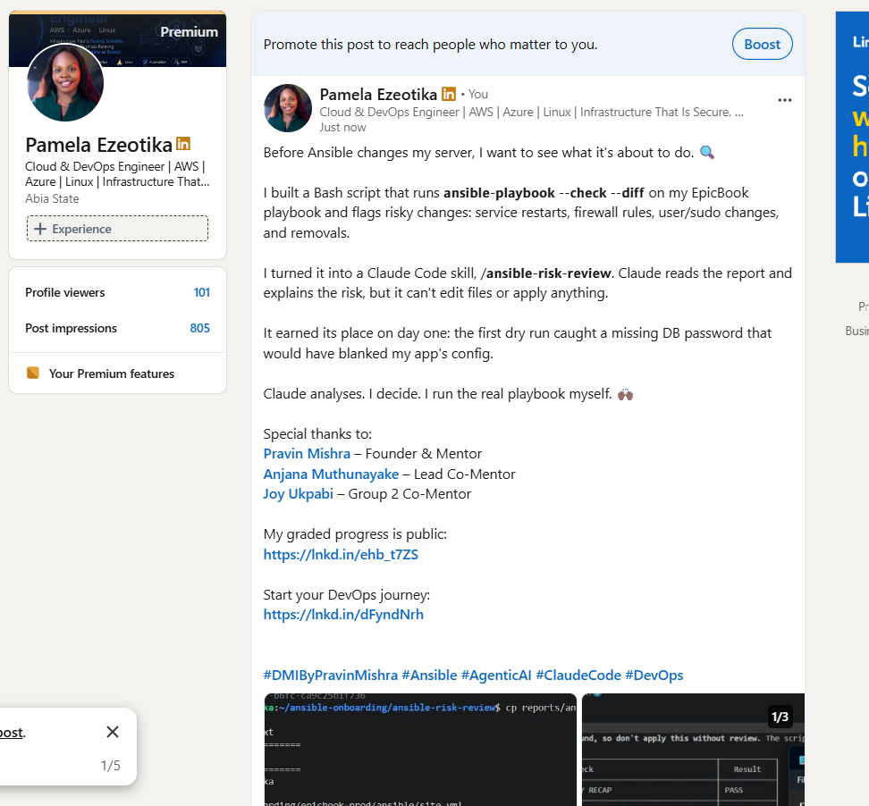

# Assignment 6 — AI-Assisted Ansible Change Risk Review

Part of the DevOps Micro Internship (DMI) with Agentic AI

---

## Purpose

In this assignment, you will build an AI-assisted Ansible risk-review workflow using `ansible-playbook --check --diff`, Bash scripting, and Claude Code.

You will review possible server changes before applying them, classify risky tasks, and keep the final apply decision under human control.

---

# Task 1 — Confirm EpicBook Connectivity and Create the Workspace

## Goal

Confirm that your previous EpicBook Ansible project is working before creating the risk-review automation.

### Evidence

#### Screenshot 1 — Output of `ansible web -i inventory.ini -m ping`

Add your screenshot here.

---

#### Screenshot 2 — Output of `ansible-playbook -i inventory.ini site.yml --syntax-check`

Add your screenshot here.

---

#### Screenshot 3 — Output of `pwd` and `find . -maxdepth 4 -type d | sort`

Add your screenshot here.

---

### Notes

Answer the following in your own words:

**1. What proves that Ansible can reach your EpicBook VM?**

The successful ping return output 

---

**2. Why should you confirm playbook syntax before building a risk-review script?**

To ensure there are no YAML syntax errors, missing indentation, or parsing issues that would cause the underlying Ansible command to crash before dry-run execution begins.

---

# Task 2 — Create Project Context and Safety Rules in CLAUDE.md

## Goal

Create a `CLAUDE.md` file that tells Claude Code how this project must behave.

### Evidence

#### Screenshot 4 — `CLAUDE.md` open in VS Code or terminal showing the safety rules

Add your screenshot here.

---

### Notes

Answer the following in your own words:

**1. Why should Claude Code have project-specific safety rules?**

To establish strict operational guardrails, restricting autonomous execution and ensuring critical infrastructure modifications always remain under human oversight.

---

**2. Why should the human run the real Ansible playbook manually?**

Because the human operator holds final operational accountability and must review risk assessments before authorizing any state-changing production apply.

---

**3. Which rule prevents Claude Code from applying changes automatically?**

The safety directive prohibiting automated playbook execution (ansible-playbook without --check) and file modifications during audit tasks.

---

# Task 3 — Ask Claude Code to Plan the Risk Review

## Goal

Use Claude Code to produce a read-only plan before writing the Bash script.

### Evidence

#### Screenshot 5 — Claude Code showing the four-category risk-classification plan

Add your screenshot here.

---

### Notes

Answer the following in your own words:

**1. Which part of this task represents the Gather phase?**

The Gather phase involved giving Claude Code the project context and asking it to inspect the requirements in CLAUDE.md. This provided the information needed to understand what the risk-review workflow should examine while keeping the activity read-only.

---

**2. Which part represents the Analyze phase?**

The Analyze phase was Claude Code reasoning about the proposed Ansible changes and organizing them into the four required categories: service restarts or handlers, firewall changes, user or sudo changes, and package or file removal. It also explained the possible real-world impact of each category.

---

**3. How did you verify Claude Code did not create or edit files?**

I explicitly instructed Claude Code not to create or edit any files. Its response remained a proposed plan rather than an implementation, and it also confirmed that it had not created or modified a file. This showed that the planning stage remained separate from implementation.

---

# Task 4 — Build the Ansible Risk Review Script

## Goal

Create a Bash script that runs an Ansible dry run and classifies risky changes.

### Evidence

#### Screenshot 6 — Top section of `ansible-check-review.sh` showing `full_name`, `playbook_path`, `inventory_path`, and the `checks` array

Add your screenshot here.

---

#### Screenshot 7 — Middle section showing `extract_changed_tasks` and `check_tasks_matching_pattern`

Add your screenshot here.

---

#### Screenshot 8 — Bottom section showing the loop, summary, and exit behavior

Add your screenshot here.

---

#### Screenshot 9 — Output of `bash -n ansible-check-review.sh` and `ls -l ansible-check-review.sh`

Add your screenshot here.

---

### Notes

Answer the following in your own words:

**1. What is stored in the `changed_tasks` array?**

The changed_tasks array stores the Ansible tasks that the dry run reports as tasks that would change the managed system. Instead of treating every playbook task as a risk, the script focuses its classification on tasks for which Ansible predicts an actual state change.

---

**2. Which function finds changed tasks from the Ansible output?**

The extract_changed_tasks function finds the changed tasks. It processes the Ansible dry-run output and extracts the task names associated with changes so they can be checked against the risk patterns.

---

**3. Why does the script use `--check --diff`?**

I used --check --diff because I wanted to see the expected effect of the playbook without intentionally applying the proposed changes. Check mode performs a dry run, while diff mode provides additional information about differences Ansible expects to make. This creates useful evidence for reviewing a change before deployment.

---

**4. Why does the script use different exit codes for healthy, warning, and failed results?**

Different exit codes make the result useful to both a human and other automation. An exit code of 0 represents a healthy result, 1 indicates that changes were detected and should be reviewed, and 2 represents risky or failed conditions. This makes the final risk state easier to identify programmatically instead of relying only on terminal text.

---

# Task 5 — Run the Baseline Dry-Run Review

## Goal

Run the script against your current EpicBook playbook and confirm the baseline risk status.

### Evidence

#### Screenshot 10 — Output of `./ansible-check-review.sh`

Add your screenshot here.

---

#### Screenshot 11 — Output of `echo "Captured Exit Code: $script_exit_code"` and `cat reports/ansible-risk-report.txt`

Add your screenshot here.

---

### Notes

Answer the following in your own words:

**1. What was the overall status of your baseline run?**

My baseline run returned an overall status of WARN. The playbook itself was reachable and did not report failed or unreachable hosts, but the dry run found tasks that would make changes. The warning therefore told me that the playbook needed review rather than indicating that the environment had failed.

---

**2. Did any tasks report `changed`?**

Yes. Four tasks were identified as changes during my baseline review: updating the apt package cache, starting and enabling Nginx, setting ownership of the EpicBook application directory, and installing the EpicBook Node.js dependencies.

---

**3. Were any changed tasks flagged as risky?**

No task in my baseline run matched the script's four formal risky categories. The script reported no service-restart, firewall, user/sudo, or removal task among the detected changes. The baseline therefore remained a warning rather than a failure.

---

**4. What does the script exit code mean?**

The baseline returned exit code 1. In my script, this means that changes were detected and human review was recommended, but the formal risk checks had not produced a failure. An exit code of 2 is reserved for a failed or risky result, while 0 represents a healthy result.
---

# Task 6 — Create and Run the Claude Code Skill

## Goal

Turn the Bash script into a reusable Claude Code skill called `/ansible-risk-review`.

### Evidence

#### Screenshot 12 — `SKILL.md` showing the frontmatter, allowed tools, and safety rules

Add your screenshot here.

---

#### Screenshot 13 — Claude Code output after running `/ansible-risk-review`

Add your screenshot here.

---

### Notes

Answer the following in your own words:

**1. Why does this skill allow `Bash`, `Read`, and `Grep`?**

The skill allows Bash, Read, and Grep because these tools are enough to execute the controlled review script, read its generated reports, and search the evidence for relevant findings. This gives Claude Code the tools it needs for analysis without giving it unnecessary write capabilities.

---

**2. Why does this skill not allow file editing?**

I deliberately excluded file-editing capability because the skill is intended to review changes, not create them. Allowing editing would weaken the separation between analysis and implementation and could let an AI-generated recommendation directly alter the playbook being reviewed.

---

**3. What part is handled by Bash?**

Bash handles the deterministic part of the workflow. The script executes the Ansible dry run, extracts changed tasks, checks them against the defined patterns, produces the risk report, calculates the summary, and returns an appropriate exit code.

---

**4. What part is handled by Claude Code?**

Claude Code handles the interpretation of the evidence. It reads the generated report, explains why particular changes could matter, describes their potential impact, and recommends whether human review is needed. It does not make the final deployment decision.

---

**5. Why is this better than asking Claude Code if the playbook is safe without giving it evidence?**

It is better because the analysis is based on actual output from ansible-playbook --check --diff rather than assumptions about what the playbook might do. The Bash script provides repeatable evidence from the environment, while Claude Code helps interpret that evidence. This makes the recommendation more grounded and auditable.

---

# Task 7 — Introduce a Controlled Risky Change and Let the Skill Catch It

## Goal

Add a small controlled risky change in your lab playbook and confirm the script and Claude Code catch it before applying.

### Evidence

#### Screenshot 14 — The added risky task inside the role file

Add your screenshot here.

---

#### Screenshot 15 — Output of `./ansible-check-review.sh`

Add your screenshot here.

---

#### Screenshot 16 — Claude Code `/ansible-risk-review` output showing the risky finding

Add your screenshot here.

---

#### Screenshot 17 — Output of `cat reports/risky-change-report.txt`

Add your screenshot here.

---

### Notes

Answer the following in your own words:

**1. Which risk category did the added task fall into?**

The controlled task fell into the package or file removal category. I deliberately added a task named Remove temporary EpicBook risk test file, which set the temporary test file to state: absent. This allowed me to test the risk-review workflow with a harmless lab example.

---

**2. What evidence proves the task would change something?**

The Ansible dry-run evidence showed would change: common : Remove temporary EpicBook risk test file. The script then reported [FAIL] 1 removal task(s) found in the changed set. This proved that the proposed removal had been identified before I executed the real playbook.

---

**3. Did Claude Code apply the playbook?**

No. Claude Code only analyzed the report produced by the read-only workflow. The real ansible-playbook command was not executed by Claude Code.

---

**4. Why is it important that Claude Code only analyzed the risk?**

Keeping Claude Code in an analysis role prevented an AI recommendation from immediately becoming a production action. Even when the AI correctly identifies a change, there may be business, security, availability, or operational information that requires human judgement. I therefore kept the final decision and execution under my control.

---

**5. Which phase of the Agentic Loop is represented by the Bash report?**

The Bash report primarily represents the Gather phase because it collects concrete evidence from the Ansible dry run. That evidence is then passed into the Analyze phase, where the risk categories and possible impact can be interpreted.

---

# Task 8 — Apply as the Human, Verify, and Write the Change Summary

## Goal

Review the risky-change report, apply the playbook manually as the human operator, and verify the result.

### Evidence

#### Screenshot 18 — Output of the real playbook run showing the final recap with `failed=0`

Add your screenshot here.

---

#### Screenshot 19 — Output of `ansible web -i inventory.ini -m ping`

Add your screenshot here.

---

#### Screenshot 20 — Second `/ansible-risk-review` output after applying the change

Add your screenshot here.

---

#### Screenshot 21 — Output of `ls -lah reports`

Add your screenshot here.

---

#### Screenshot 22 — `change-summary.md` showing all required sections and your Full Name

Add your screenshot here.

---

### Notes

Answer the following in your own words:

**1. What command did you run to apply the change for real?**

ansible-playbook -i inventory.ini site.yml

---

**2. Who made the final decision to apply the playbook?**

The human operator (Pamela Chidinma Ezeotika), following the review of the risk assessment report.

---

**3. What evidence proves the VM is still reachable?**

The successful ping execution (ansible web -i inventory.ini -m ping) returning pong

---

**4. Why should the risk review be run again after applying?**

To verify that the system state has successfully converged to expected parameters and that no residual drifts or warnings remain.

---

**5. What could go wrong if an AI agent applied Ansible changes automatically?**

An unvetted high-risk change or misinterpretation could disrupt production services, corrupt databases, or introduce security vulnerabilities without human oversight.

---

# LinkedIn Post Required

## Evidence

#### LinkedIn Post URL

Paste your LinkedIn post URL here:

https://lnkd.in/p/eQ7Wb6X7

---

#### Screenshot — Published LinkedIn post

---

# Required Files

Confirm that the following files are included in your GitHub repository or assignment folder:

- [x] `CLAUDE.md`
- [x] `ansible-check-review.sh`
- [x] `.claude/skills/ansible-risk-review/SKILL.md`
- [x] `reports/risky-change-report.txt`
- [x] `reports/post-apply-report.txt`
- [x] `change-summary.md`

---

# Submission Instructions

- Add all required screenshots in your submission.
- Full Name must be visible in required screenshots and reports.
- All required notes must be answered clearly.
- Do not expose SSH private keys, passwords, cloud credentials, database credentials, or secret environment variables.
- Add your GitHub repository or folder URL inside this document.

---

# Completion Checklist

- [ ] Task 1: EpicBook connectivity confirmed and workspace created
- [ ] Task 2: `CLAUDE.md` created with safety rules
- [ ] Task 3: Claude Code produced a read-only risk-review plan
- [ ] Task 4: `ansible-check-review.sh` created and syntax checked
- [ ] Task 5: Baseline dry-run review completed
- [ ] Task 6: Claude Code `/ansible-risk-review` skill created and tested
- [ ] Task 7: Controlled risky change introduced and detected
- [ ] Task 8: Human applied the change and verified the result
- [ ] Risky-change report saved
- [ ] Post-apply report saved
- [ ] Change summary completed
- [ ] All screenshots added
- [ ] All notes answered
- [ ] LinkedIn post published
- [ ] LinkedIn post URL added
- [ ] No sensitive information exposed

---

## About DMI & CloudAdvisory

DevOps Micro Internship (DMI) is a project-based DevOps program run by Pravin Mishra and The CloudAdvisory, focused on real-world execution, systems thinking, and career readiness.

It helps learners build strong DevOps foundations with hands-on experience.

---

## Resources

- DMI Official Website: [https://dmi.pravinmishra.com?utm_source=github&utm_medium=readme](https://dmi.pravinmishra.com?utm_source=github&utm_medium=readme)
- University: [https://university.pravinmishra.com?utm_source=github&utm_medium=readme](https://university.pravinmishra.com?utm_source=github&utm_medium=readme)
- Discord Community: [https://discord.pravinmishra.com?utm_source=github&utm_medium=readme](https://discord.pravinmishra.com?utm_source=github&utm_medium=readme)
- Blog: [https://dmi.pravinmishra.com/blog?utm_source=github&utm_medium=readme](https://dmi.pravinmishra.com/blog?utm_source=github&utm_medium=readme)
- YouTube Playlist: [https://www.youtube.com/playlist?list=PLFeSNDtI4Cho](https://www.youtube.com/playlist?list=PLFeSNDtI4Cho)
- Pravin Mishra LinkedIn: [https://www.linkedin.com/in/pravin-mishra-aws-trainer/](https://www.linkedin.com/in/pravin-mishra-aws-trainer/)
- CloudAdvisory LinkedIn: [https://www.linkedin.com/company/thecloudadvisory/](https://www.linkedin.com/company/thecloudadvisory/)

---

*This submission is part of DevOps Micro Internship (DMI) — Agentic AI Track.*