# Assignment 7 — Capstone: Deploy a Production-Grade Stack for The EpicBook

Part of the DevOps Micro Internship (DMI) with Agentic AI

---

## Purpose

In this assignment, you will deploy the EpicBook application as a production-oriented Docker Compose stack on a cloud VM. You will use optimized container images, isolated networks, health checks, persistent MySQL storage, a selected reverse proxy, logging, backup and restore testing, and reliability procedures.

---

# Task 0 — App Discovery and Architecture

## Goal

Review the EpicBook repository and design the intended application architecture.

### Evidence

#### Screenshot 1 — EpicBook Project Structure

Add a terminal screenshot showing the EpicBook project structure after cloning the repository.

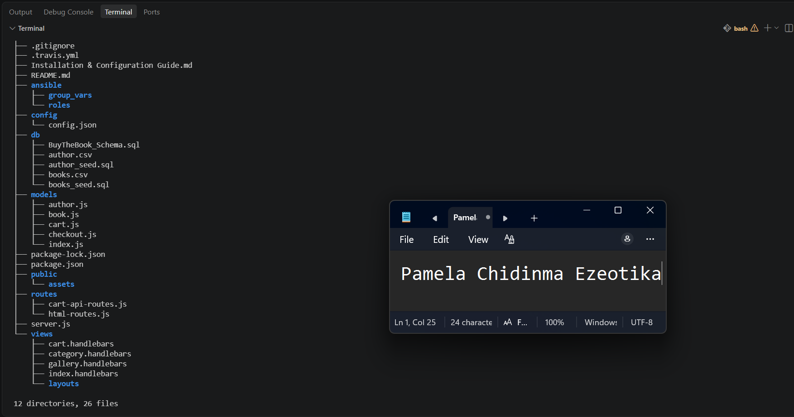

---

#### Screenshot 2 — Architecture Diagram

Add a screenshot of your architecture diagram showing:

- Public user
- Reverse proxy
- Frontend
- Backend
- Database
- Docker networks
- Public and private ports
- Persistent database storage

Add your full name inside the diagram or as a clear caption below it.

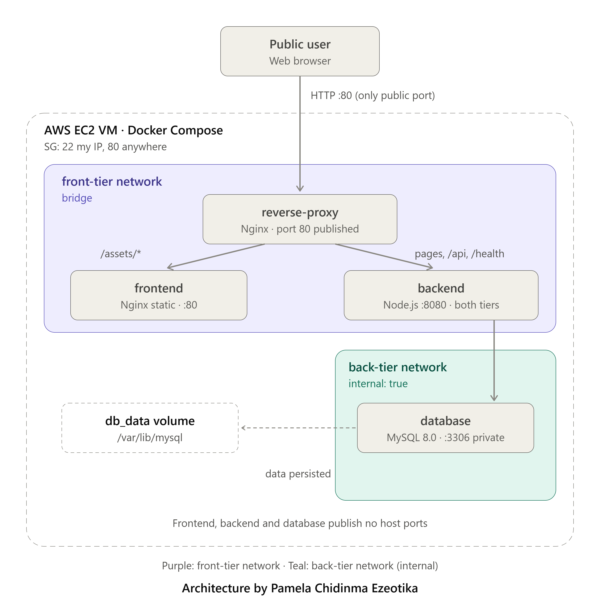

---

#### Screenshot 3 — Environment Variables and Ports Document

Add a screenshot showing the contents of:

```text
docs/02-env-and-ports.md
```

It must document environment-variable names, internal ports, persistent-data details, and the health-check method. Do not expose real credentials or values.

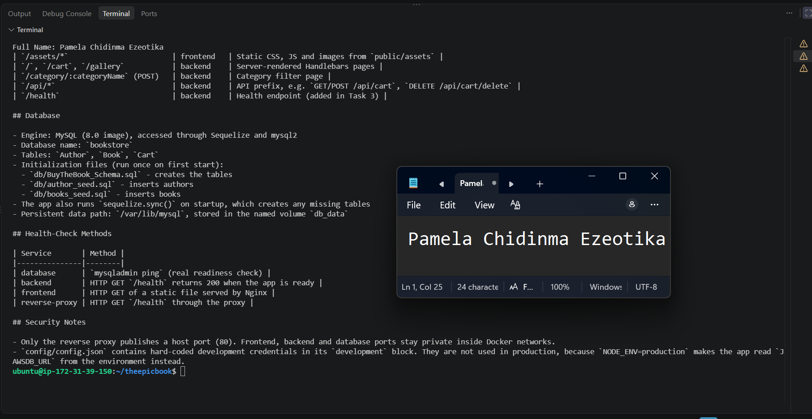

---

# Task 1 — Create Production Docker Images

## Goal

Create optimized production images for the EpicBook backend and frontend.

### Evidence

#### Screenshot 4 — Backend Dockerfile

Add a screenshot showing `backend/Dockerfile`, including:

- Dependency stage
- Minimal runtime stage
- Production startup command
- Internal backend port
- Non-root user configuration

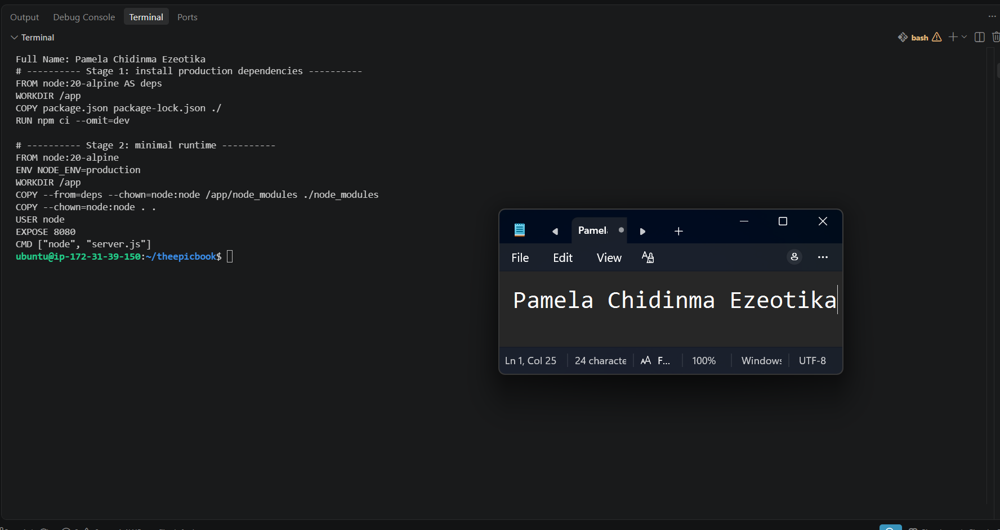

---

#### Screenshot 5 — Frontend Dockerfile

Add a screenshot showing `frontend/Dockerfile`, including:

- Nginx runtime image
- Static frontend files copied to the Nginx web root

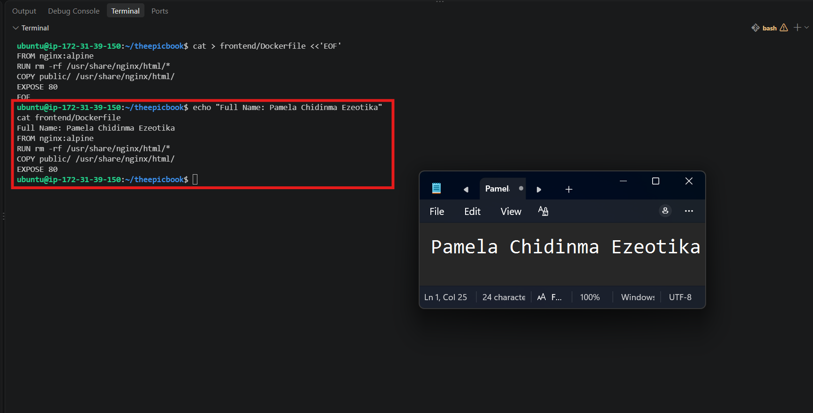

---

#### Screenshot 6 — Docker Ignore Files

Add a screenshot showing both:

```text
backend/.dockerignore
frontend/.dockerignore
```

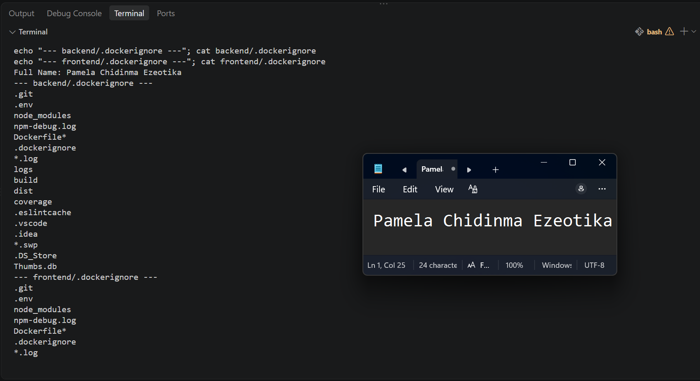

---

#### Screenshot 7 — Docker Image Builds and Size Comparison

Add a terminal screenshot showing successful builds of:

- Baseline backend image
- Optimized backend image
- Frontend image

The screenshot must also show the baseline and optimized backend image-size comparison.

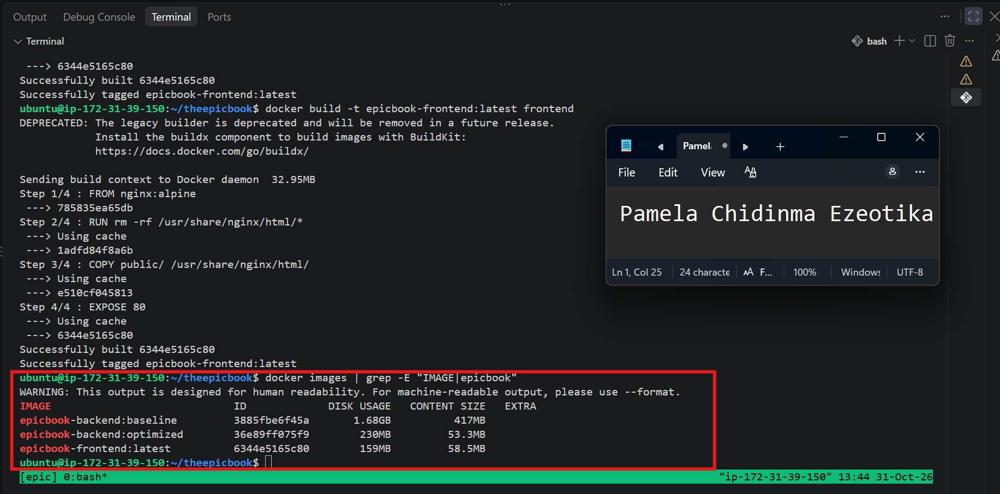

---

#### Screenshot 8 — Backend Running as Non-Root User

Add a terminal screenshot showing the optimized backend container running as a non-root user.

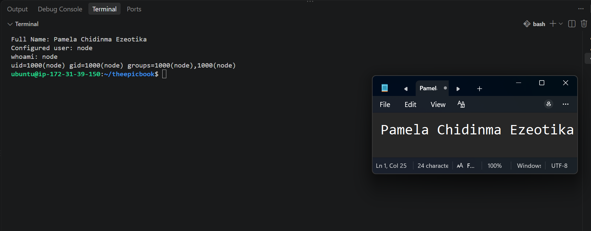

---

### Notes

Write a short note covering:

- Baseline and optimized backend image sizes
- The image-size reduction achieved
- One Docker layer-caching optimization used
- The security benefit of running the backend as a non-root user

Image sizes: The baseline single-stage backend image (node:20, all dependencies) is 1.68 GB. The optimized multi-stage backend image (node:20-alpine, production dependencies only) is 230 MB.

Reduction: ((1680 − 230) ÷ 1680) × 100 = 86.31% smaller (87.22% by compressed content size, 417 MB vs 53.3 MB).

Layer-caching optimization: package.json and package-lock.json are copied and npm ci --omit=dev runs before the application source is copied. When only code changes, Docker reuses the cached dependency layer instead of reinstalling every package, so rebuilds are much faster.

Non-root security benefit: The backend runs as the built-in node user (uid 1000) instead of root. If an attacker exploited the application, they would be limited to that user’s permissions inside the container. They couldn’t install software, change system files, or easily escalate further, which reduces the damage a compromise could cause.

---

# Task 2 — Create the Docker Compose Stack and Networks

## Goal

Create one Docker Compose stack containing the reverse proxy, frontend, backend, and MySQL database.

### Evidence

#### Screenshot 9 — Docker Compose Services

Add a screenshot showing `docker-compose.yml` with all four services:

```text
reverse-proxy
frontend
backend
database
```

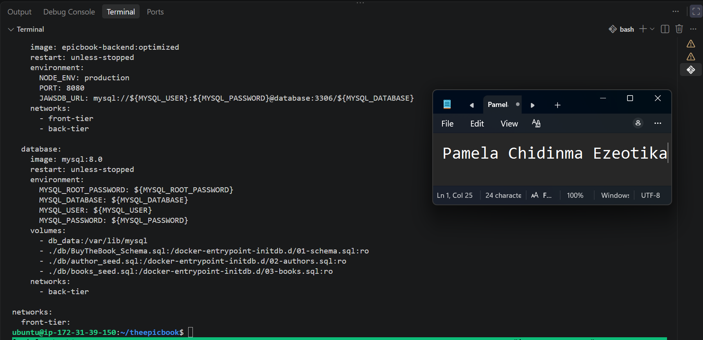

---

#### Screenshot 10 — Networks and Named Volume

Add a screenshot showing:

- `front-tier` network
- `back-tier` network
- `db_data` named volume

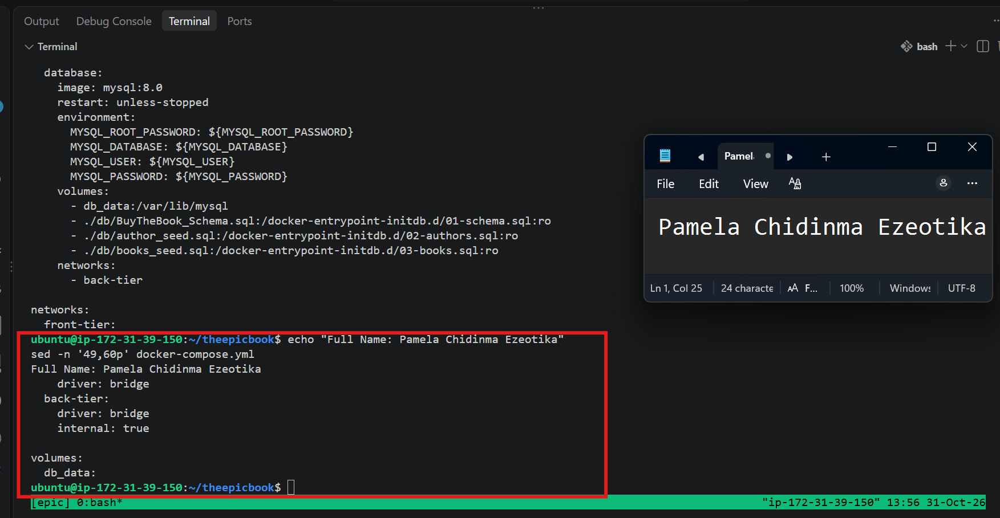

---

#### Screenshot 11 — Docker Compose Validation

Add a terminal screenshot showing successful Docker Compose validation without exposing environment-variable values or secrets.

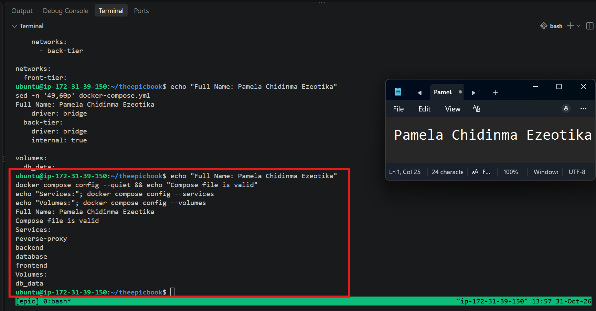

---

# Task 3 — Configure Health Checks and Startup Dependencies

## Goal

Configure health checks and ensure services start only after their dependencies are healthy.

### Evidence

#### Screenshot 12 — Backend Health Endpoint

Add a screenshot showing the backend application configuration for the `/health` endpoint.

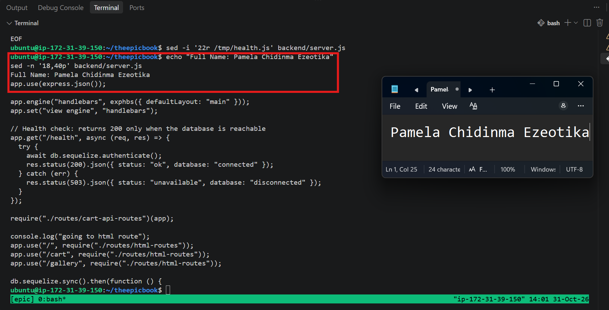

---

#### Screenshot 13 — MySQL and Backend Health Checks

Add a screenshot showing `docker-compose.yml` with health checks for MySQL and the backend.

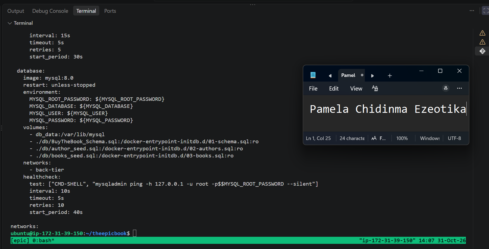

---

#### Screenshot 14 — Frontend and Reverse-Proxy Health Checks

Add a screenshot showing:

- Frontend health check
- Reverse-proxy health check
- `depends_on` conditions using `service_healthy`

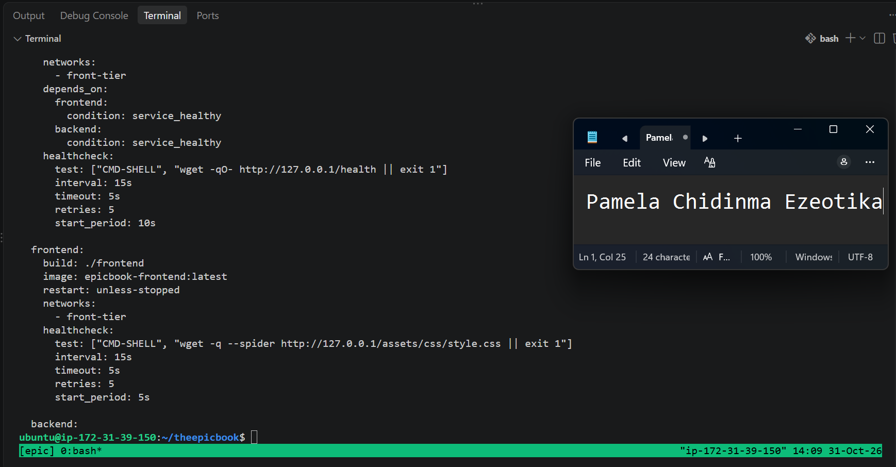

---

#### Screenshot 15 — Running Healthy Services

Add a terminal screenshot showing Docker Compose service status. The database, backend, frontend, and reverse proxy must be running successfully.

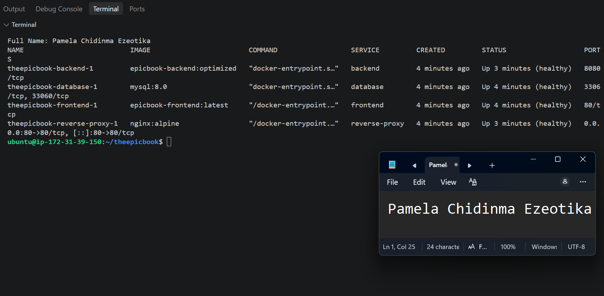

---

#### Screenshot 16 — Public Health Endpoint

Add a terminal screenshot showing a successful response from the public application health endpoint through the reverse proxy.

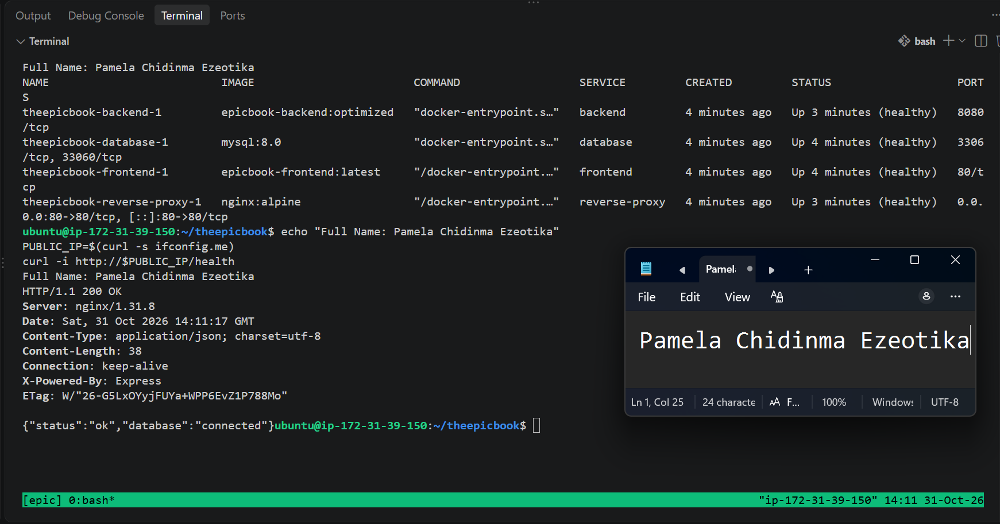

---

#### Screenshot 17 — Health-Check and Startup-Order Document

Add a screenshot showing the contents of:

```text
docs/03-healthchecks-and-depends-on.md
```

Explain the health-check method for each service and the startup dependency order.

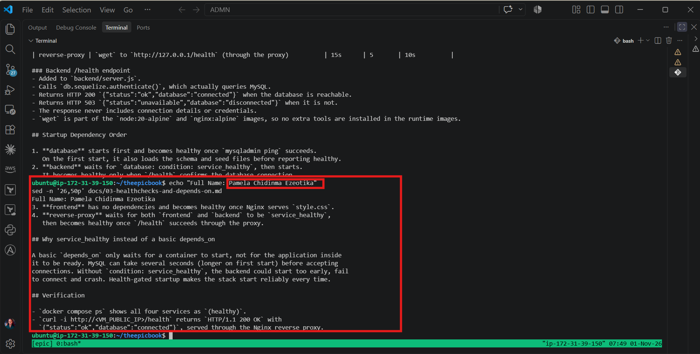

---

# Task 4 — Configure the Reverse Proxy and Same-Origin Routing

## Goal

Use either Nginx or Traefik as the only public entry point for the EpicBook application.

### Evidence

#### Screenshot 18 — Selected Reverse-Proxy Configuration

Add a screenshot showing the configuration for your selected reverse proxy.

It must show routes for:

- Static frontend assets
- Application pages
- API requests
- Health endpoint

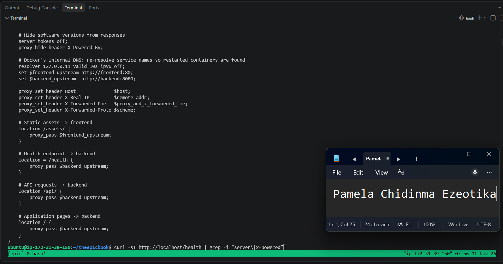

---

#### Screenshot 19 — Only Reverse Proxy Publishes Port 80

Add a screenshot of `docker-compose.yml` showing that only the `reverse-proxy` service publishes port 80.

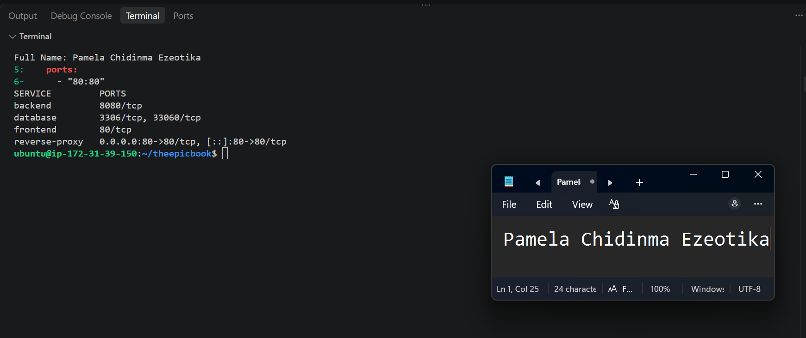

---

#### Screenshot 20 — Reverse-Proxy Route Testing

Add a terminal screenshot showing successful requests through the selected reverse proxy to:

- Application page
- One API endpoint
- One static asset
- Health endpoint

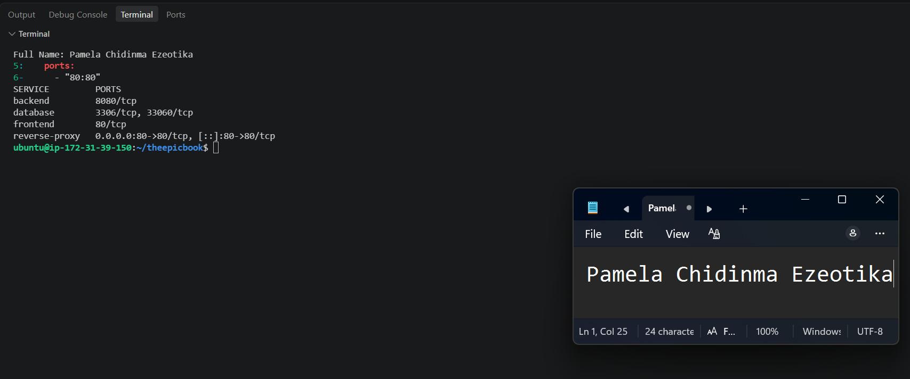

---

#### Screenshot 21 — EpicBook Application Through Public IP

Add a browser screenshot showing the EpicBook application loaded through the VM public IP address.

Add your full name as a clear caption below the screenshot.

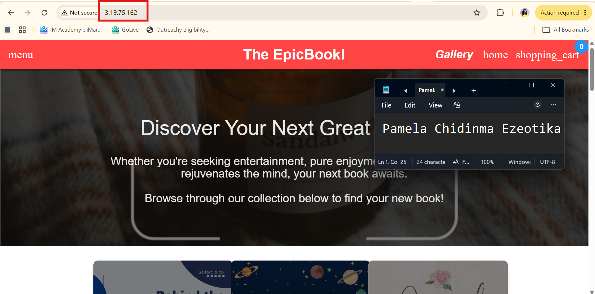

---

#### Screenshot 22 — Proxy Routing and CORS Document

Add a screenshot showing the contents of:

```text
docs/04-proxy-routing-and-cors.md
```

Explain the proxy routes and state whether CORS was required and why.

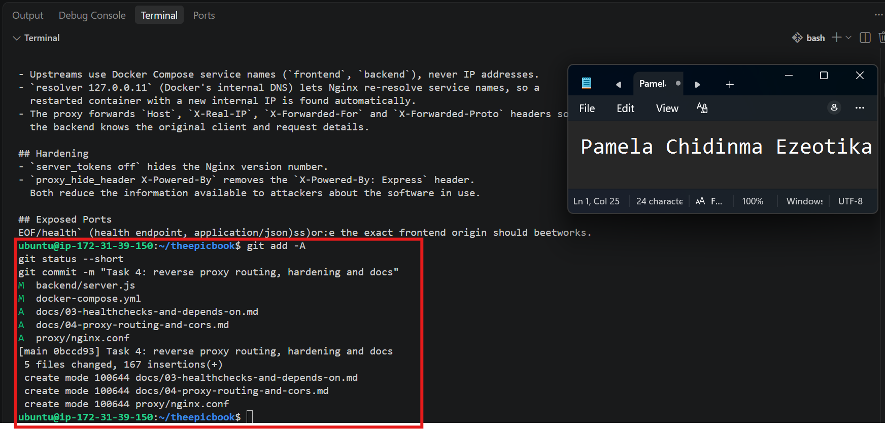

---

# Task 5 — Prove Data Persistence, Backup, and Restore

## Goal

Verify MySQL persistence and perform a controlled backup and restore drill.

### Evidence

#### Screenshot 23 — MySQL Volume Configuration

Add a terminal screenshot showing the `db_data` named volume and its MySQL mount configuration.

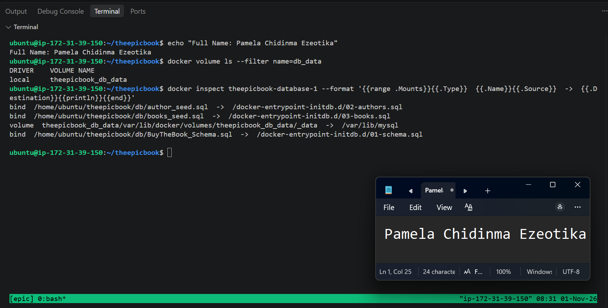

---

#### Screenshot 24 — Test Data Before Backup

Add a terminal screenshot showing the selected test data before the backup and restore drill.

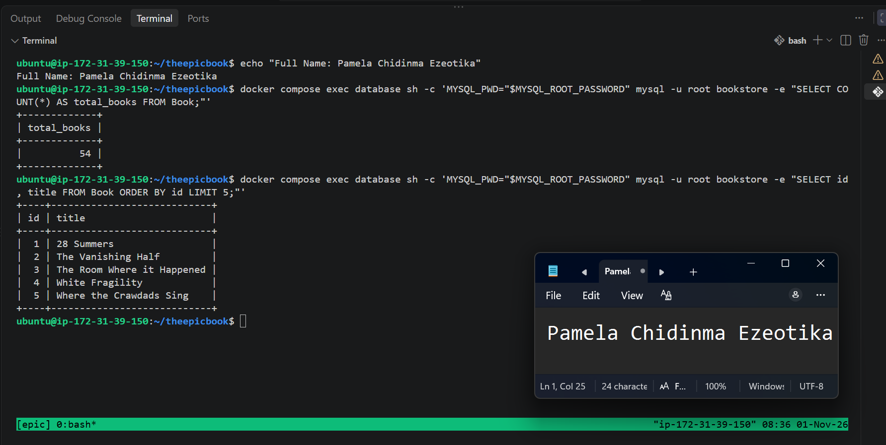

---

#### Screenshot 25 — Successful Backup Creation

Add a terminal screenshot showing successful backup creation and the backup file stored in the host backup directory.

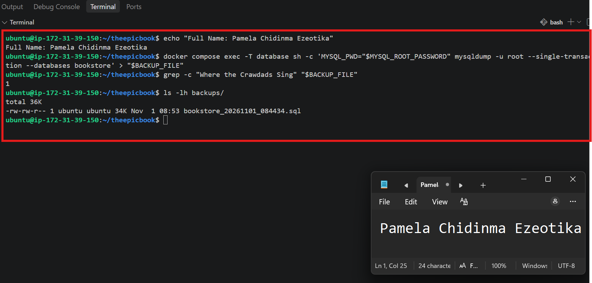

---

#### Screenshot 26 — Controlled Data-Loss Test

Add a terminal screenshot showing that the selected test record was removed during the controlled data-loss test.

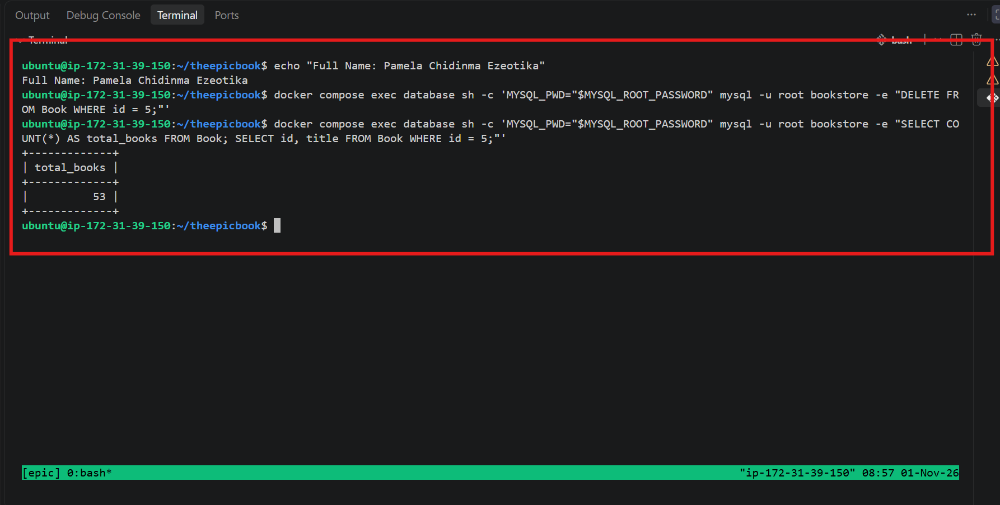

---

#### Screenshot 27 — Restore Verification

Add a terminal screenshot showing successful restore and verification that the deleted test record is available again.

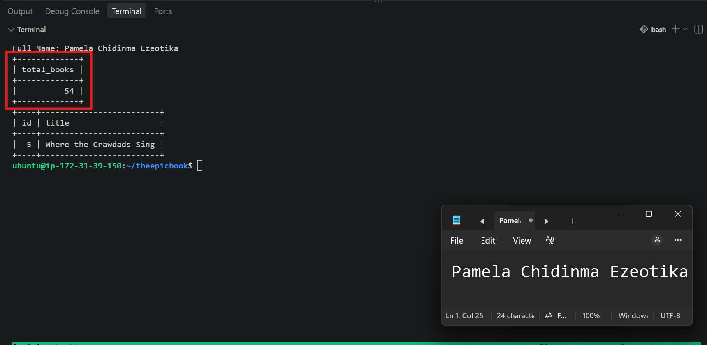

---

#### Screenshot 28 — Persistence After Down/Up Cycle

Add a terminal screenshot showing that database data remains available after a non-destructive Docker Compose down/up cycle.

Do not use `docker compose down -v`.

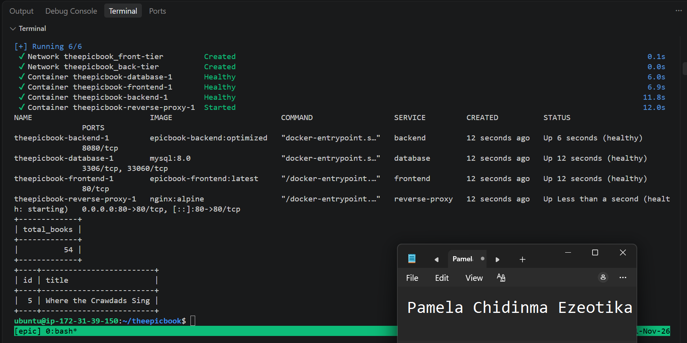

---

#### Screenshot 29 — Persistence and Backup Document

Add a screenshot showing the contents of:

```text
docs/05-persistence-and-backup.md
```

Include the backup plan and restore procedure.

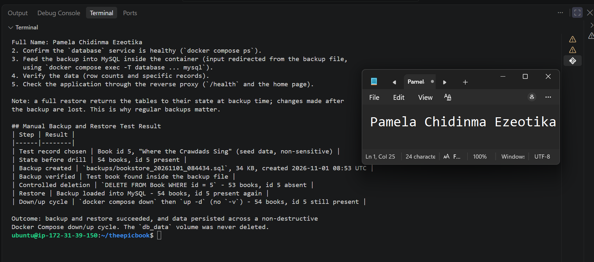

---

# Task 6 — Configure Logging and Observability

## Goal

Configure useful reverse-proxy and backend logs without exposing sensitive information.

### Evidence

#### Screenshot 30 — Logging Configuration

Add a screenshot showing:

- Configuration for the selected reverse proxy
- Proxy log format
- Docker Compose host log-directory bind mount


---

#### Screenshot 31 — Persistent Proxy Logs and Backend Logs

Add a terminal screenshot showing:

- Selected reverse-proxy logs available from the host directory after a proxy restart
- Backend logs displayed through Docker Compose

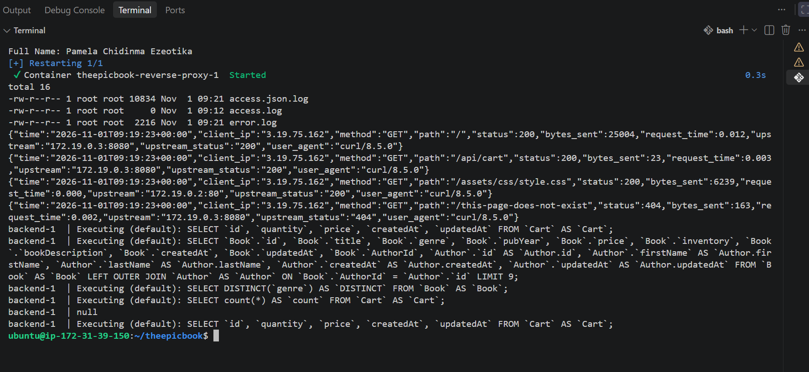

---

### Notes

Write a short note covering:

- The selected reverse proxy
- Host path used for reverse-proxy logs
- How backend logs are viewed
- Whether JSON or standard text logs were used
- Why passwords, tokens, headers, and database connection strings must not appear in logs

Selected reverse proxy: Nginx (nginx:alpine).

Host path for proxy logs: ~/theepicbook/logs/proxy/ on the VM, bind-mounted to /var/log/nginx in the reverse-proxy container. It contains access.json.log (requests) and error.log (warnings and errors). The folder is in .gitignore.

Viewing backend logs: the backend writes to stdout and stderr, viewed with docker compose logs backend (add --tail=N for recent lines or -f to follow live).

Log format: structured JSON access logs (log_format ... escape=json). Each request is one JSON object with time, client IP, method, path, status, bytes sent, response time, upstream service and upstream status. The upstream field shows which service handled each request: frontend :80 for /assets/, backend :8080 for pages, API and health.

Why secrets must not appear in logs: logs are copied to many places (log servers, backups, support tickets) and read by many people, usually with weaker protection than the database. A password, token, authorization header, session ID or connection string in a log could let anyone who reads it impersonate users or access the database. For this reason, the log format records the path without query strings and never logs headers, cookies or request bodies. Health-check traffic and SQL query logging add noise. In production they would be filtered or reduced, so real problems stand out.

---

# Task 7 — Deploy and Verify the Stack on a Cloud VM

## Goal

Deploy the completed Docker Compose stack on an AWS or Azure VM and verify public access.

### Evidence

#### Screenshot 32 — VM Public IP and Inbound Rules

Add a cloud-console screenshot showing:

- VM public IP address
- SSH port 22 restricted to your IP address
- HTTP port 80 allowed from Anywhere

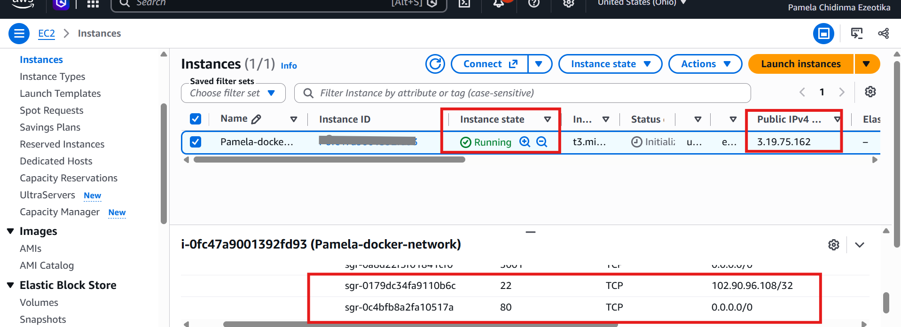

---

#### Screenshot 33 — Cloud VM Stack Verification

Add a VM terminal screenshot showing:

- Docker Compose service status
- Successful public health or API response
- No published database, frontend, or backend ports

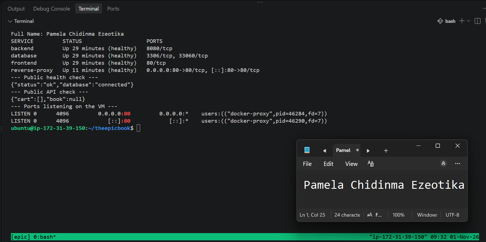

---

#### Screenshot 34 — EpicBook Application on Cloud VM

Add a browser screenshot showing the EpicBook application loaded through the VM public IP address.

Add your full name as a clear caption below the screenshot.

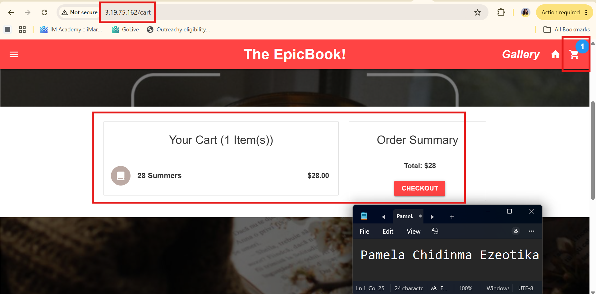

---

### Notes

Write a short note covering:

- Cloud provider used
- VM operating system
- Public port exposed
- Security rules configured
- Confirmation that the application and backend API worked through the reverse proxy

Cloud provider: AWS (EC2, Ubuntu 24.04 LTS, t3.micro, us-east-2 Ohio). Docker Engine, Docker Compose v2 and Git installed. 2 GB swap added for stability on 1 GB RAM.

Final application URL: http://3.19.75.162 (the public IP changes when the instance is stopped and started).

Public port exposed: 80 (HTTP), on the Nginx reverse-proxy container only. SSH (22) is allowed from my IP address only.

Private ports kept closed: MySQL 3306, backend 8080 and frontend 80 are reachable only inside the Docker networks (front-tier and the internal back-tier). They are not published to the host and not allowed in the security group. ss -tlnp confirmed that only port 80 is listening on the VM.

Verification: all four services reported healthy. /health returned {"status":"ok","database":"connected"} through the public IP, and /api/cart returned JSON from the backend. In the browser, EpicBook loaded through the VM public IP, the book list was retrieved from MySQL, and clicking “Add to cart” sent a successful API request (cart count updated from 0 to 1). A non-destructive docker compose down / up -d cycle was completed on this VM, and the application started successfully again with all data intact.

---

# Task 8 — Automate Deployment with CI/CD (Optional)

## Goal

Optionally automate image build, image push, and deployment through GitHub Actions or Azure Pipelines.

### Optional Evidence

#### Optional Screenshot — Successful CI/CD Pipeline Run

Add a screenshot showing a successful pipeline run with build, image push, deployment, and verification stages.

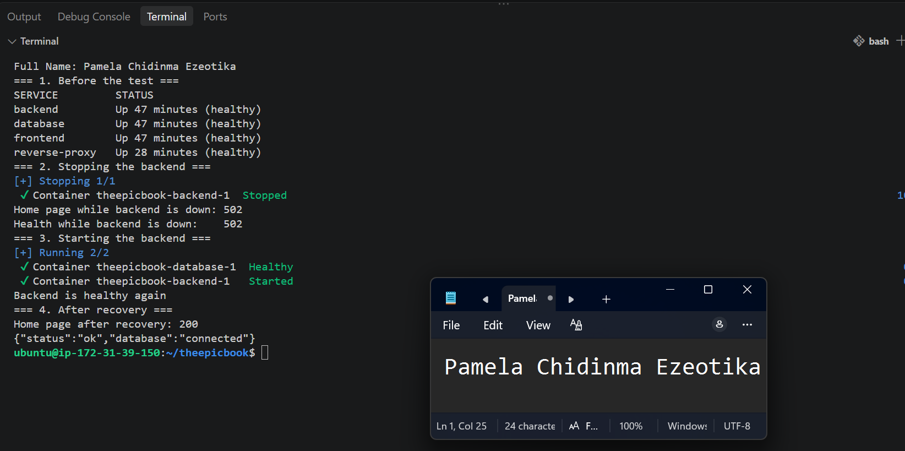

---

### Optional Notes

Write a short note covering:

- CI/CD platform used
- Image-tagging method
- Registry used
- Deployment trigger
- Manual approval or secret-handling approach

CI/CD automation was not implemented as part of this assignment. The optional task was left for future improvement. A future implementation could use GitHub Actions or Azure Pipelines to build and tag the application images, push them to a container registry, deploy the updated Docker Compose stack to the cloud VM, and perform post-deployment health checks. Deployment credentials and registry secrets would be stored using the CI/CD platform's secure secret-management mechanism rather than committed to the repository.

---

# Task 9 — Perform Reliability Tests and Create an Operations Runbook

## Goal

Test controlled service failures and document safe operating procedures.

### Evidence

#### Screenshot 35 — Backend Failure and Recovery

Add a terminal screenshot showing:

- Backend failure test
- Expected unavailable response through the reverse proxy
- Backend restart
- Successful health-check recovery


---

#### Screenshot 36 — Database Failure and Recovery

Add a terminal screenshot showing:

- Database outage test
- Failed database-dependent request
- Database restart
- Successful application recovery

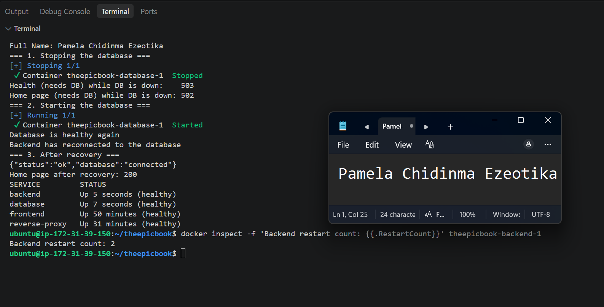

---

### Notes

Write a short operations runbook covering:

- Safe restart procedure for reverse proxy, frontend, backend, and database
- Backup and restore procedure
- Secret-rotation approach
- Database recovery procedure
- What to check when the application returns an error
- Results of backend and database reliability tests


1. Safe restart procedure
The EpicBook stack consists of the reverse proxy, frontend, backend, and database services. Service status should first be checked with docker compose ps.

Individual services can be restarted with docker compose restart <service>. When restarting the complete stack, docker compose down followed by docker compose up -d can be used. The -v option must not be added to docker compose down during a normal restart because it can remove the persistent database volume.
After a restart, docker compose ps should be used to confirm that the services have returned to a running and healthy state.


2. Backup and restore procedure

Backup:
docker compose exec -T database sh -c 'MYSQL_PWD="$MYSQL_ROOT_PASSWORD" mysqldump -u root --single-transaction --databases bookstore' > backups/bookstore_$(date +%Y%m%d_%H%M%S).sql
Backups are stored in backups/ on the VM, outside the container, and excluded from Git. Run one daily, and before every change. Keep 7 daily and 4 weekly backups, and copy them off the VM.

Restore:
docker compose exec -T database sh -c 'MYSQL_PWD="$MYSQL_ROOT_PASSWORD" mysql -u root' < backups/<file>.sql
Then verify row counts, /health and the home page. A restore returns the data to its state at backup time.

3. Secret-rotation approach

Generate a new password (openssl rand -hex 16), change it in MySQL with ALTER USER, update .env on the VM, and recreate the services with docker compose up -d. Check that /health reports connected. Rotate every 90 days, after any suspected leak, and when someone with access leaves. Secrets live only in .env, which is never committed and has permissions set to 600.

4. Database recovery procedure
Check the status and logs: docker compose ps, then docker compose logs database --tail=50.
If MySQL is stopped or unhealthy: docker compose start database, then wait for (healthy).
If the backend crashed meanwhile, Docker’s restart: unless-stopped brings it back. Confirm the backend is (healthy).
If data is missing or corrupted: restore the latest good backup (section 2).
Verify with the checks in section 5.

The db_data volume is never deleted during recovery.


5. What to check when the application returns an error
If the application returns an error, I would check the Docker Compose service status and health checks first. I would then inspect the reverse-proxy and backend logs, verify that the required containers are running, confirm Docker network connectivity, and check whether the database is healthy.

I would also verify the Nginx routing configuration, environment variables, internal service names and ports, and the application's HTTP health endpoints. Sensitive values such as passwords and tokens should not be printed while troubleshooting.

6. Results of the reliability tests
During the backend reliability test, the backend service was deliberately made unavailable to confirm how the reverse proxy behaved during a controlled service failure. After the backend was restarted and became healthy again, the application/API response recovered successfully.

During the database reliability test, the database service was deliberately made unavailable and a database-dependent request was tested. The request failed as expected while the database was unavailable. After restarting the database and allowing it to become healthy, the application recovered and database-dependent functionality became available again.

These tests confirmed that the individual services can be restarted and recovered without rebuilding the entire environment or losing the persistent database data.

---

# Final Public Application URL

**EpicBook URL:** `http://3.19.75.162

Replace the placeholder with your working public URL.

---

# GitHub Repository URL

**Your Fork or Repository URL:** https://github.com/Ella3323/theepicbook


# LinkedIn Requirement

## Goal

Create a professional LinkedIn post of 6–10 lines about your EpicBook capstone deployment.

Your post must include:

- The architectural decision that most improved reliability
- Your biggest image-size reduction, with numbers
- Key production-hardening lessons
- A deployment verification image

### Evidence

**LinkedIn Post URL:** https://www.linkedin.com/feed/update/urn:li:activity:7523939565548609539/

#### LinkedIn Post Screenshot

Add a screenshot of the published LinkedIn post showing the text body and deployment verification image.

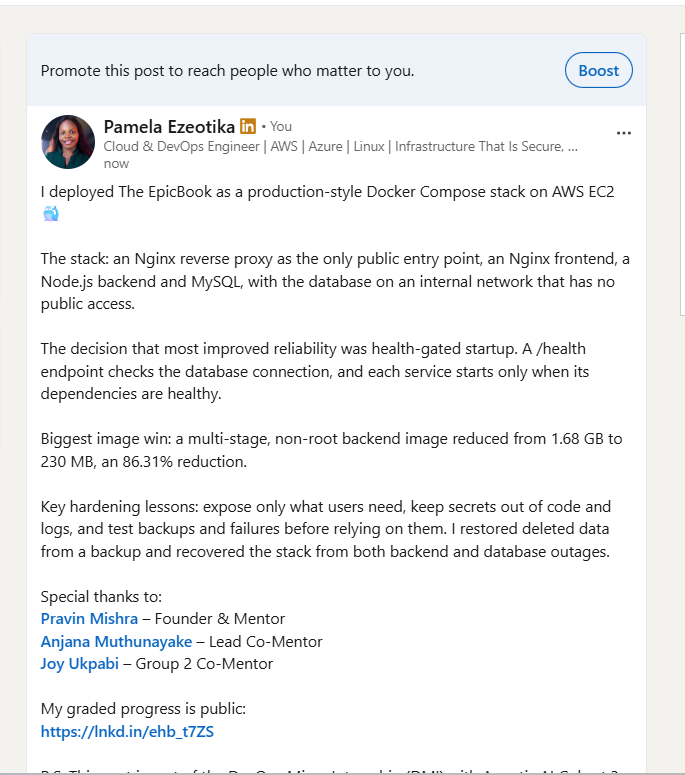
---

# Submission Checklist

- [x] EpicBook repository reviewed and architecture diagram created
- [x] Environment variables, ports, persistence, and health-check details documented
- [x] Backend and frontend production Dockerfiles created
- [x] Backend runs as a non-root user
- [x] Docker image-size comparison completed
- [x] Docker Compose stack includes reverse proxy, frontend, backend, and database
- [x] `front-tier` and `back-tier` networks configured
- [x] `db_data` named volume configured
- [x] MySQL, backend, frontend, and reverse-proxy health checks configured
- [x] Startup dependencies use `service_healthy`
- [x] Nginx or Traefik selected as the only public reverse proxy
- [x] Only reverse-proxy port 80 is publicly published
- [x] Same-origin routing configured and CORS used only when required
- [x] Backup, restore, and persistence testing completed
- [x] Reverse-proxy and backend logs verified
- [x] Cloud VM deployment verified through the public IP
- [x] Backend and database reliability tests completed
- [x] Screenshots 1–36 included
- [x] Required notes completed
- [x] LinkedIn post URL and screenshot included
- [x] Full name visible in required screenshots or captions
- [x] No passwords, tokens, private keys, account IDs, or other sensitive information exposed

---

## 📌 About DMI & CloudAdvisory

DevOps Micro Internship (DMI) is a project-based DevOps program run by Pravin Mishra (The CloudAdvisory) focused on real-world execution, systems thinking, and career readiness.

It helps learners build strong DevOps foundations with hands-on experience.

---

## 📌 Resources

- 🌐 DMI Official Website: https://dmi.pravinmishra.com?utm_source=github&utm_medium=readme  
- 🎓 University: https://university.pravinmishra.com?utm_source=github&utm_medium=readme  
- 💬 Discord Community: https://discord.pravinmishra.com?utm_source=github&utm_medium=readme  
- 📝 Blog: https://dmi.pravinmishra.com/blog?utm_source=github&utm_medium=readme  
- ▶️ YouTube Playlist: https://www.youtube.com/playlist?list=PLFeSNDtI4Cho  
- 🔗 Pravin Mishra (LinkedIn): https://www.linkedin.com/in/pravin-mishra-aws-trainer/  
- 🏢 CloudAdvisory (LinkedIn): https://www.linkedin.com/company/thecloudadvisory/

---

*This submission is part of DevOps Micro Internship (DMI) — Agentic AI Track.*
