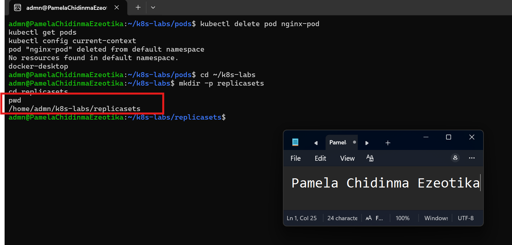
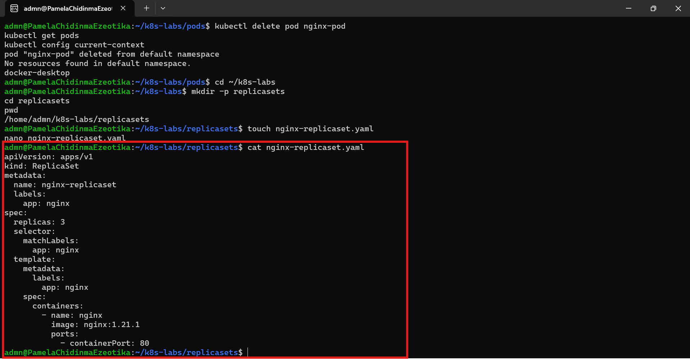
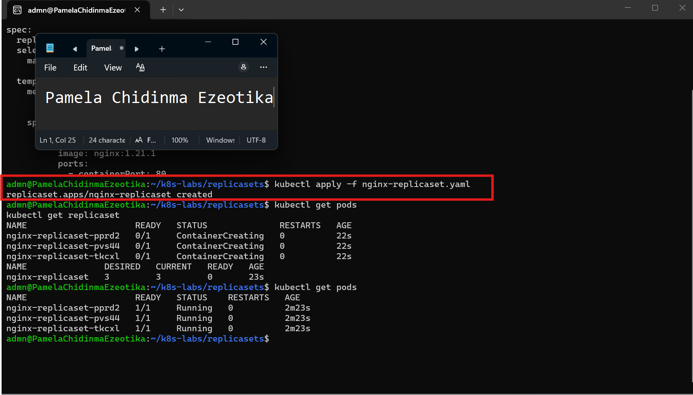
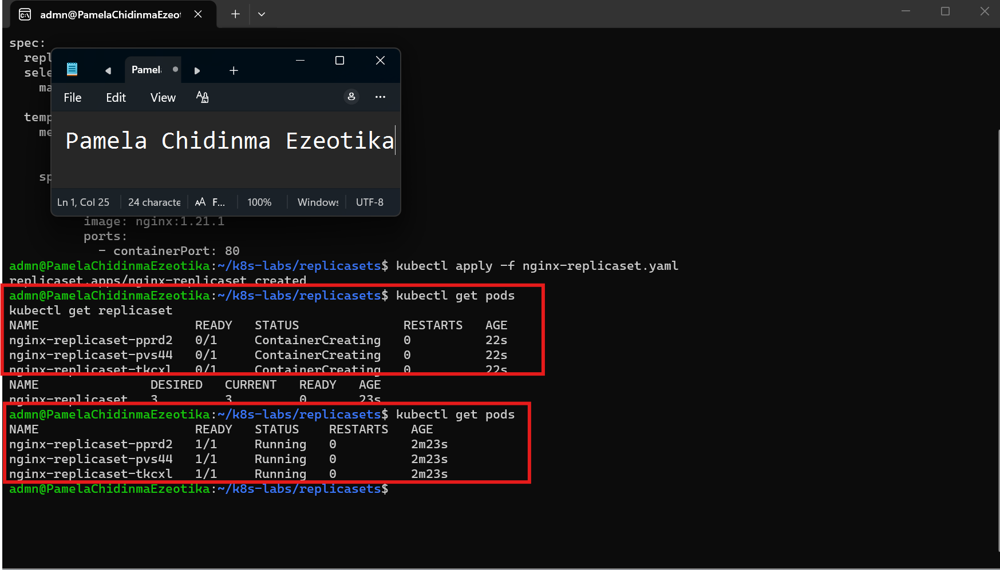
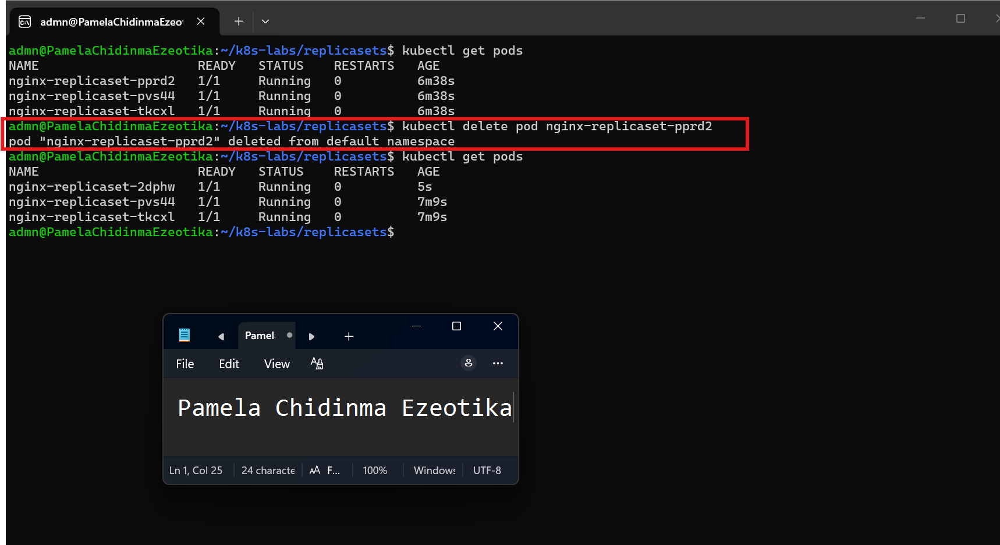
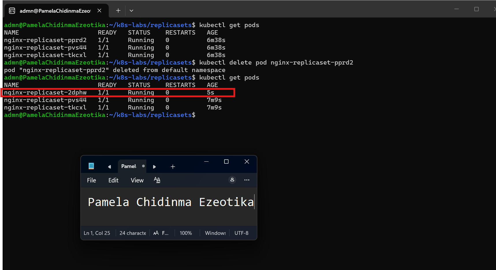
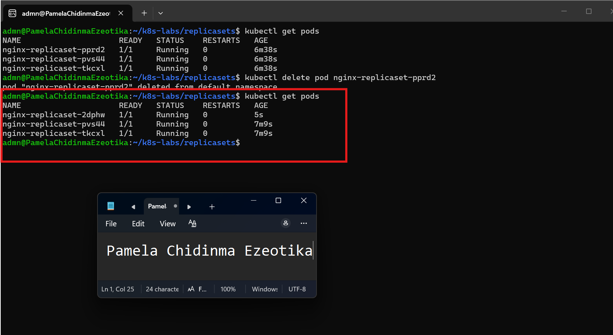
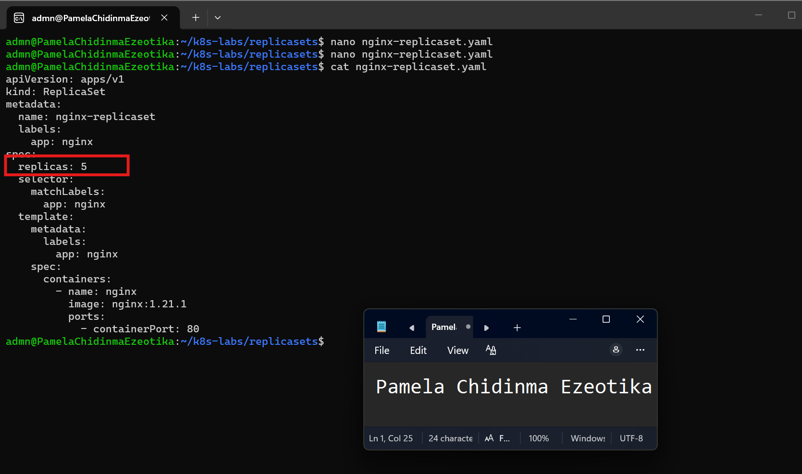
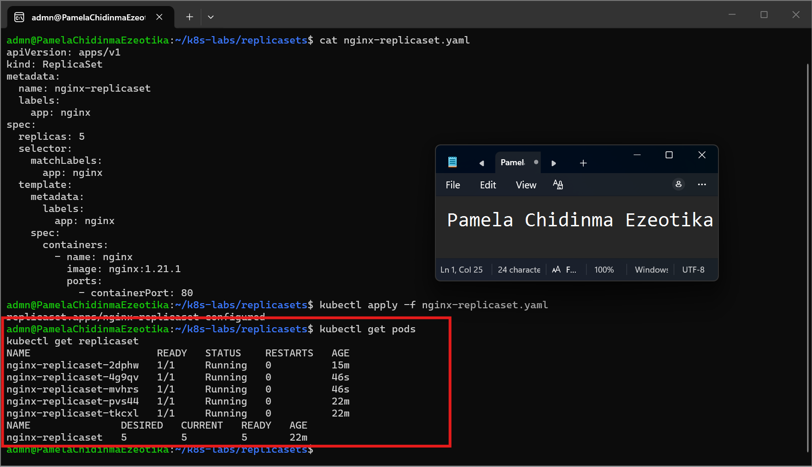

# Assignment 02 — ReplicaSets: Keeping Your Pods Alive

Part of the DevOps Micro Internship (DMI) with Agentic AI

---

## Purpose

In this assignment, you will create three NGINX Pods using a ReplicaSet, test auto-healing by deleting one Pod, and scale the ReplicaSet from three to five Pods.

---

# Task 0 — Pre-check: Remove the Pod from Assignment 01

## Goal

Confirm that you are connected to your learning cluster and remove the previous standalone Pod to prevent the ReplicaSet from adopting it.

### Evidence

No screenshots required.

---

# Task 1 — Set Up Your Working Directory

## Goal

Create and enter a dedicated directory for this ReplicaSet lab.

### Evidence

#### Screenshot 01 — Output of `pwd` showing the working directory ending in `/k8s-labs/replicasets`

---

### Notes

**1. Why is it useful to keep Kubernetes manifests in organized directories?**

Keeping manifests in organized directories, such as ~/k8s-labs/pods for Pod files, makes each file easy to find, understand and reuse. Related resources sit together, so it’s clear which files belong to which part of an application. A clean structure also works well with Git: changes can be tracked, reviewed and rolled back, and teammates can apply exactly the same files to get the same result. It also makes it easy to apply a whole folder at once with kubectl apply -f <directory>, and it reduces mistakes such as applying the wrong file to a cluster.

---

**2. What file will you create in this directory for this assignment?**

I will create nginx-pod.yaml inside ~/k8s-labs/pods. It’s a declarative manifest that defines a Pod named nginx-pod, with the label app: nginx, one container named nginx-container using the official nginx image, and container port 80. I apply it with kubectl apply -f nginx-pod.yaml.

---

# Task 2 — Create and Apply the NGINX ReplicaSet

## Goal

Create a ReplicaSet that maintains three NGINX Pods.

### Evidence

#### Screenshot 02 — Completed `nginx-replicaset.yaml` manifest showing `replicas: 3`

---

#### Screenshot 03 — Output of `kubectl apply -f nginx-replicaset.yaml`

---

#### Screenshot 04 — Output of `kubectl get pods` showing three NGINX Pods with `1/1` under `READY` and `Running` under `STATUS`

---

### Notes

**1. What does `replicas: 3` mean in this manifest?**

It sets the desired number of Pods to three. The ReplicaSet makes sure exactly three Pods matching its selector are running at all times, creating new ones if there are too few and removing extras if there are too many.

---

**2. Why must `selector.matchLabels` match `template.metadata.labels`?**

The selector is how the ReplicaSet finds and counts the Pods it manages. Every Pod it creates from the template gets the labels in template.metadata.labels. If those labels didn’t match the selector, the ReplicaSet couldn’t recognize its own Pods, so it would keep creating new ones without ever reaching the desired count. Kubernetes rejects a ReplicaSet whose selector doesn’t match its template labels, to prevent exactly this.

---

**3. What image and image tag are used for the NGINX container?**

The official nginx image with the tag 1.21.1 (nginx:1.21.1). A specific version tag means every Pod runs exactly the same version, rather than whatever latest points to at the time.

---

# Task 3 — Test ReplicaSet Auto-Healing

## Goal

Delete one Pod managed by the ReplicaSet and observe Kubernetes automatically create a replacement.

### Evidence

#### Screenshot 05 — Output of the command deleting one ReplicaSet-managed Pod

---

#### Screenshot 06 — Output of `kubectl get pods` showing the replacement Pod with a different name from the deleted Pod

---

#### Screenshot 07 — Output showing three NGINX Pods with `1/1` under `READY` and `Running` under `STATUS` again

---

### Notes

**1. What happened after you deleted one Pod?**

The Pod I deleted (nginx-replicaset-pprd2) was terminated and removed. Almost immediately, Kubernetes created a new Pod (nginx-replicaset-2dphw) with a different name and a much younger age, and within a few seconds it reached 1/1 Running.

---

**2. How does the ReplicaSet know that a replacement Pod is needed?**

The ReplicaSet controller runs a continuous reconciliation loop. It compares the desired count (replicas: 3) with the number of running Pods that match its selector (app: nginx). When one Pod was deleted, the current count dropped to two, so the controller created one new Pod from its template to bring the count back to three.

---

**3. What proves that auto-healing worked successfully?**

kubectl get pods showed three Pods with 1/1 Running again, including one new Pod with a different name and a very recent age. kubectl get replicaset nginx-replicaset also showed 3 for DESIRED, CURRENT and READY. I didn’t create the replacement myself, so the ReplicaSet restored the desired state on its own.

---

# Task 4 — Manually Scale the ReplicaSet

## Goal

Scale the ReplicaSet from three NGINX Pods to five NGINX Pods by changing the YAML manifest.

### Evidence

#### Screenshot 08 — Updated `nginx-replicaset.yaml` showing `replicas: 5`

---

#### Screenshot 09 — Output of `kubectl get pods` showing five NGINX Pods with `1/1` under `READY` and `Running` under `STATUS`

---

### Notes

**1. What change did you make to scale the ReplicaSet?**

I changed one line in nginx-replicaset.yaml, under spec, from replicas: 3 to replicas: 5, then reapplied the manifest with kubectl apply -f nginx-replicaset.yaml.

---

**2. Did you manually create the additional Pods? Explain why or why not.**

No. I only changed the desired count in the manifest. When I reapplied it, the ReplicaSet saw five Pods were wanted but only three existed, so it created two new Pods from its template automatically. That’s the declarative approach: I describe the state I want, and Kubernetes does the work to reach it.

---

**3. What would happen if you changed the replica count from five back to three?**

The ReplicaSet would see five running Pods against a desired count of three, so it would automatically terminate two Pods until exactly three remained. No manual deletion would be needed.

---

# LinkedIn Requirement

Create a LinkedIn post that includes:

- A short explanation of what a Kubernetes ReplicaSet does.
- What happened when you deleted one NGINX Pod.
- How Kubernetes automatically created a replacement Pod to maintain the desired replica count.
- What you learned by changing the replica count from three to five.
- One screenshot showing either:
  - Three Pods running after the auto-healing test, or
  - Five Pods running after scaling the ReplicaSet.

Do not share sensitive information, cluster credentials, tokens, or kubeconfig details in your post.

### Evidence

#### Screenshot 10 — Published LinkedIn post showing your name, the required explanation, and the attached Pod screenshot

Add your screenshot here.

---

### Post Link

Add the URL of your published LinkedIn post here.

---

# Submission Instructions

- Add all required screenshots, numbered 01–10, to this template.
- Full Name must be visible in required screenshots.
- Ensure screenshots are clear and readable.
- Submit the final `nginx-replicaset.yaml` file showing `replicas: 5`. Screenshot 02 provides evidence of the initial manifest with `replicas: 3`.
- Complete the Notes sections in Tasks 1–4 in your own words.
- Include the published LinkedIn post URL.
- Do not expose tokens, passwords, private keys, kubeconfig files, or account IDs.

---

# Completion Checklist

- [ ] Completed Task 0 and confirmed that the previous `nginx-pod` is no longer listed
- [ ] Created and entered the ReplicaSet working directory (Screenshot 01)
- [ ] Created `nginx-replicaset.yaml` with an initial replica count of three (Screenshot 02)
- [ ] Applied the ReplicaSet manifest successfully (Screenshot 03)
- [ ] Confirmed three NGINX Pods are running (Screenshot 04)
- [ ] Deleted one ReplicaSet-managed Pod (Screenshot 05)
- [ ] Observed the automatically created replacement Pod (Screenshot 06)
- [ ] Confirmed three NGINX Pods are running again (Screenshot 07)
- [ ] Changed the replica count from three to five (Screenshot 08)
- [ ] Confirmed five NGINX Pods are running (Screenshot 09)
- [ ] Submitted the final `nginx-replicaset.yaml` file with `replicas: 5`
- [ ] Completed the Notes sections in Tasks 1–4
- [ ] Published the LinkedIn post with the required explanation and Pod screenshot (Screenshot 10)
- [ ] Included the published LinkedIn post URL
- [ ] Included all required screenshots
- [ ] No sensitive data exposed

---

## 📌 About DMI & CloudAdvisory

DevOps Micro Internship (DMI) is a project-based DevOps program run by Pravin Mishra (The CloudAdvisory) focused on real-world execution, systems thinking, and career readiness.

It helps learners build strong DevOps foundations with hands-on experience.

---

## 📌 Resources

- 🌐 DMI Official Website: https://dmi.pravinmishra.com?utm_source=github&utm_medium=readme  
- 🎓 University: https://university.pravinmishra.com?utm_source=github&utm_medium=readme  
- 💬 Discord Community: https://discord.pravinmishra.com?utm_source=github&utm_medium=readme  
- 📝 Blog: https://dmi.pravinmishra.com/blog?utm_source=github&utm_medium=readme  
- ▶️ YouTube Playlist: https://www.youtube.com/playlist?list=PLFeSNDtI4Cho  
- 🔗 Pravin Mishra (LinkedIn): https://www.linkedin.com/in/pravin-mishra-aws-trainer/  
- 🏢 CloudAdvisory (LinkedIn): https://www.linkedin.com/company/thecloudadvisory/

---

*This submission is part of DevOps Micro Internship (DMI) — Agentic AI Track.*
